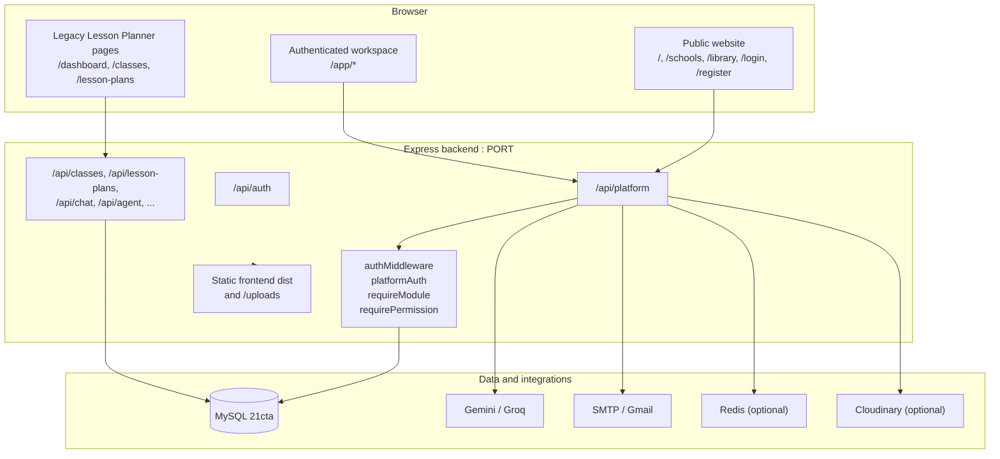

# 21CTA — Master Documentation

**Project:** 21st Century Teacher Assistant (21CTA)
**Document:** Consolidated master documentation
**Version:** 1.0
**Date:** 8 November 2026
**Status:** Local development platform; not deployed to production
**Repository:** `C:\Users\USER\Documents\21CTA`
**Canonical source of truth:** this document and the current application code

---

## About this document

This is the single consolidated reference for the 21CTA platform. It replaces the
previous collection of root-level reports and legacy planning documents, which have
been moved to `docs/archive/` (see [Appendix A](#appendix-a-documentation-consolidation-map)).
It describes what is actually implemented, what is partial, and what is only planned.
Where older documents contradicted the code, the code was treated as authoritative and
the contradiction is recorded.

### Status labels used in this document

| Label | Meaning |
|---|---|
| **Implemented** | Present in the current codebase and exercisable through the running application or API. |
| **Partial** | Present but limited, dependent on an external service, or available only through a subset of the intended UI. |
| **Planned** | Described in plans or roadmap material but not implemented in the current tree. |
| **Superseded** | Historical design that has been replaced by the implemented architecture. |
| **Not verified** | Claimed by an older document but not reproducible from the current code or test tree. |

### Important truth notes

1. The implemented platform is the unified **Express + React/Vite + MySQL** application
   under `apps/lesson-planner/`. The legacy `apps/marks/`, `RMS-MMS-main/`, and
   `digital_lesson_plan-main/` trees are retained as source lineage and reference.
2. There is **no production deployment**. The platform runs locally (frontend Vite dev
   server and backend Express server). There is no DNS, domain, TLS certificate, or
   production hosting configuration in the repository.
3. Several older documents claim "100% complete", "production-ready", "54/54 tests pass",
   and a build of "3857 modules". Those claims are **not reproducible** from the current
   tree: the backend test script is a placeholder and only the RMS marks test files exist.
   The frontend build was measured during this documentation pass and transformed
   **3860 modules** successfully (see §35).
4. The root `.env.example` says port 5000; the backend falls back to **5001** when `PORT`
   is unset or occupied; the frontend defaults to **5000**. This is a real configuration
   inconsistency and is documented in §33.
5. Exposed credentials listed in the key-rotation runbook remain **unrotated** and must be
   treated as compromised. See `docs/security/KEY_ROTATION_RUNBOOK.md`.

---

## Table of contents

1. [Project Overview](#1-project-overview)
2. [Vision, Mission and Objectives](#2-vision-mission-and-objectives)
3. [Target Users](#3-target-users)
4. [Key Features](#4-key-features)
5. [System Architecture](#5-system-architecture)
6. [Technology Stack](#6-technology-stack)
7. [Repository and Project Structure](#7-repository-and-project-structure)
8. [Modules Overview](#8-modules-overview)
9. [Module 1: 21st Century Lesson Planner](#9-module-1-21st-century-lesson-planner)
10. [Module 2: Marks Information System](#10-module-2-marks-information-system)
11. [Module 3: Digital Library](#11-module-3-digital-library)
12. [Module 4: Assessment and Examination Portal](#12-module-4-assessment-and-examination-portal)
13. [Module 5: Digital Class Diary](#13-module-5-digital-class-diary)
14. [Module 6: Student Attendance](#14-module-6-student-attendance)
15. [Module 7: Teacher Attendance](#15-module-7-teacher-attendance)
16. [Module 8: Timetable Management](#16-module-8-timetable-management)
17. [Module 9: AI Teaching Assistant](#17-module-9-ai-teaching-assistant)
18. [Module 10: CPD and Professional Development](#18-module-10-cpd-and-professional-development)
19. [Module 11: Teacher Professional Portfolio](#19-module-11-teacher-professional-portfolio)
20. [Module 12: Student Management](#20-module-12-student-management)
21. [Module 13: Teacher Management](#21-module-13-teacher-management)
22. [Module 14: Parent Management](#22-module-14-parent-management)
23. [Module 15: School Management](#23-module-15-school-management)
24. [Module 16: Communication and Notifications](#24-module-16-communication-and-notifications)
25. [Module 17: Analytics and Reporting](#25-module-17-analytics-and-reporting)
26. [Module 18: User, Role and Permission Management](#26-module-18-user-role-and-permission-management)
27. [Public Website and School Portals](#27-public-website-and-school-portals)
28. [Database Architecture](#28-database-architecture)
29. [API Reference](#29-api-reference)
30. [Authentication, Authorization and Security](#30-authentication-authorization-and-security)
31. [Business Rules and Invariants](#31-business-rules-and-invariants)
32. [Installation and Local Setup](#32-installation-and-local-setup)
33. [Environment Configuration](#33-environment-configuration)
34. [Deployment, Backup and Operations](#34-deployment-backup-and-operations)
35. [Testing, Project Status, Roadmap and Support](#35-testing-project-status-roadmap-and-support)

---

## 1. Project Overview

21CTA (**21st Century Teacher Assistant**) is a multi-school education platform designed
for Rwandan schools. It brings a public website, a shared login, role-based dashboards, and
a set of teaching and school-administration modules into one application backed by one
MySQL database.

The platform combines two originally separate systems:

| Original system | Role in 21CTA | Current location |
|---|---|---|
| 21st Century Lesson Plan Generator | Lesson planning, curriculum, materials, AI assistance | `apps/lesson-planner/` (frontend + backend) |
| RMS-MIS Marks Management | Marks entry, approval, locking, reporting | `apps/marks/` (legacy source), integrated into the platform API and schema |
| Legacy snapshots | Historical reference only | `digital_lesson_plan-main/`, `RMS-MMS-main/` |

### What the implemented platform provides

- One public website with a landing page, school directory, public library, registration,
  contact, FAQ, privacy policy, and documentation pages.
- One authentication flow (`POST /api/auth/login`) issuing a bearer token.
- One authenticated workspace at `/app/*` with role-aware navigation and 22 module records.
- One centralized MySQL database named `21cta`, with `school_id` isolation on school-owned
  records.
- Backend-enforced RBAC, module guards, school scoping, and audit logging.
- 18 documented educational modules (some share a module record or are exposed through a
  generic resource API; see §8).

### Current operating state

| Area | State |
|---|---|
| Backend | Implemented; Express app under `apps/lesson-planner/backend`, mounted at `/api`. |
| Frontend | Implemented; React 18 + Vite 5 under `apps/lesson-planner/frontend`. |
| Database | MySQL/MariaDB `21cta`; schema and seed scripts present. |
| Public website | Implemented for the routes listed in §27. |
| School portals | Implemented through public school endpoints and `school_public_profiles`. |
| Production hosting | **Not deployed**; no domain, DNS, TLS, or hosting credentials in the repo. |
| Secret rotation | **Pending**; see `docs/security/KEY_ROTATION_RUNBOOK.md`. |
| Source control | Git repository; branch and pull-request status are tracked by the repository host. |

### Scope of this document

This document covers the platform application, its database, API, security model, setup,
operations, testing, and known gaps. It does not modify application code. Legal ownership
and third-party attribution are described in §35.

---

## 2. Vision, Mission and Objectives

### Documented positioning

The repository does not contain a formally approved board-level vision or mission statement.
The canonical positioning used throughout the project is:

- **Tagline:** *Empowering Teachers Through Technology and Innovation.*
- **Purpose:** give every approved school one website, one login, one identity, and one
  role-aware workspace while preserving the proven lesson-planning and marks workflows.
- **Approach:** centralize access and data without discarding existing business logic.

This section therefore records the documented vision and mission as project positioning,
not as a legal or governance instrument. A formal statement can be adopted later without
changing the platform.

### Vision

A unified, multi-school education platform in which teachers, school leaders, students,
parents, and education administrators in Rwanda can access the tools and records they need
from one trusted system, with school data kept separate and permissions enforced by the
server.

### Mission

1. Preserve the existing Lesson Planner and RMS-MIS functionality while integrating them.
2. Provide one authentication and identity model for all users.
3. Enforce school-level isolation and role-based access on every protected request.
4. Give each approved school a public portal and a private workspace.
5. Support the languages used in Rwandan schools: English, French, Kinyarwanda, and
   Kiswahili.
6. Keep the system modular so a school or the platform owner can enable or disable modules.

### Objectives

| # | Objective | Evidence / status |
|---|---|---|
| 1 | One website, one login, one user identity | Implemented via `/api/auth/login` and `/api/platform/me`. |
| 2 | Multi-school isolation with role-based permissions | Implemented in `platformService.js` and `platformAuth.js`. |
| 3 | Preserve Lesson Planner workflows | Legacy pages and APIs retained; unified workspace offers read-only lesson-plan views. |
| 4 | Preserve marks entry, approval, locking, and reporting | Implemented in the marks resource and lifecycle endpoints. |
| 5 | Shared student, teacher, class, subject, and academic records | Implemented in the platform schema and resource API. |
| 6 | Modular support for library, assessment, diary, attendance, timetable, CPD, analytics | Implemented at API/resource level; UI depth varies by module. |
| 7 | Public school directory and per-school portals | Implemented for the current public routes and portal profile table. |
| 8 | Multilingual interface | Implemented in the platform i18n dictionaries (en/fr/rw/sw). |
| 9 | Safe administrative controls for schools and platform settings | Implemented for super admin and school admin scopes. |
| 10 | Production deployment with backups and secret rotation | **Planned / pending**; not complete. |

---

## 3. Target Users

### Primary user groups

| User group | Examples | What they need |
|---|---|---|
| Platform owner | Super administrator | Cross-school administration, module control, registrations, audit, platform settings. |
| School leadership | School administrator, headteacher, director of studies (DOS), head of department (HOD) | School profile, staff and student oversight, approvals, reports, timetable, attendance. |
| Teachers | Subject and class teachers | Lesson planning, marks, attendance, diary, timetable, library, CPD, AI assistance. |
| Students | Learners with accounts | View own classes, approved marks, attendance, assessments, timetable, library, announcements. |
| Parents / guardians | Linked parent accounts | View their linked child's approved marks, attendance, assessments, timetable, and announcements. |
| School operations staff | Librarian, secretary, accountant, ICT administrator, examination officer, CPD coordinator, support staff | Role-specific administrative, library, examination, ICT, finance-adjacent, and CPD tasks. |
| Public visitors | Prospective parents, schools, partners | Public website, school directory, school portals, public library, registration. |
| Platform team | Developers and operators | Setup, configuration, deployment, backup, testing, and maintenance. |

### Role catalogue (15 roles)

The seed data defines these role codes:

| Role code | Display name | Scope |
|---|---|---|
| `super_admin` | Super Administrator | Platform-wide; bypasses school and module checks. |
| `school_admin` | School Administrator | One school. |
| `headteacher` | Headteacher | One school. |
| `dos` | Director of Studies | One school; academic approvals. |
| `teacher` | Teacher | One school; own classes and subjects. |
| `student` | Student | One school; own records. |
| `parent` | Parent / Guardian | One school; linked children. |
| `librarian` | Librarian | One school; library operations. |
| `secretary` | School Secretary | One school; administrative support. |
| `accountant` | Accountant | One school; finance-adjacent records and reports. |
| `ict_admin` | ICT Administrator | One school; user and system support. |
| `exam_officer` | Examination Officer | One school; assessments and examinations. |
| `hod` | Head of Department | One school; department oversight. |
| `cpd_coordinator` | CPD Coordinator | One school; professional development. |
| `staff` | Support Staff | One school; general access. |

The older README referred to "17 roles". The actual role table contains **15 role codes**;
the demo data contains **17 demo accounts** because some roles have more than one demo
account. See §32 for the demo account list.

### Target institutions

Approved schools across Rwanda, including general secondary schools and model schools in
the seed data. The `schools` table records school type, ownership, district, province,
sector, cell, contact details, subscription plan, and status. School-specific public
content is stored in `school_public_profiles`.

---

## 4. Key Features

### Implemented features

| Area | Feature | Status |
|---|---|---|
| Public site | Landing page, about, FAQ, contact, privacy policy, documentation, pricing | Implemented |
| Public site | School directory and per-school public portal | Implemented |
| Public site | Public digital library browse/detail/preview | Implemented |
| Public site | School and user registration requests | Implemented |
| Authentication | Email/password login, registration, JWT bearer sessions | Implemented |
| Authentication | Password change, forgot password, reset password | Implemented |
| Authentication | Optional Google OAuth | Partial; only enabled when Google credentials are configured |
| Workspace | Role-aware dashboard and navigation | Implemented |
| Workspace | School switcher via `X-School-Id` header | Implemented |
| Workspace | 22 module records with enable/disable control | Implemented |
| Workspace | Generic CRUD for 22 resources | Implemented with per-resource permissions and scopes |
| Lesson planning | Lesson-plan list/search/filter in unified workspace | Implemented (read-only resource) |
| Lesson planning | Creation/editing/AI generation through legacy Lesson Planner pages | Implemented in legacy app; not re-exposed as platform CRUD |
| Marks | Entry, edit, approve, lock, reopen, delete with ownership rules | Implemented |
| Marks | CSV report export | Implemented through `/api/platform/reports/marks/export?format=csv` |
| Library | Resources, loans, borrow/return | Implemented |
| Assessment | Assessments, questions, submissions, grading fields | Implemented at resource level |
| Diary | Class diary entries | Implemented |
| Attendance | Student attendance, bulk entry, teacher attendance | Implemented |
| Timetable | Weekly timetable slots | Implemented |
| AI assistant | Chat endpoint and assistant page | Partial; requires configured AI provider keys |
| CPD | Activities, enrollments, portfolio | Implemented at resource level |
| Notifications | Notification list, read/unread, announcements | Implemented |
| Reporting | Enrollment, attendance, marks, library, CPD, school summary; CSV export | Implemented |
| Administration | Users, schools, registrations, settings, audit, module toggles | Implemented |
| Security | bcrypt hashing, JWT, RBAC, school isolation, module guards, rate limits, audit log | Implemented |
| Multilingual | English, French, Kinyarwanda, Kiswahili dictionaries | Implemented |

### Partial or externally dependent features

| Feature | Limitation |
|---|---|
| AI generation and AI assistant | Needs `GEMINI_API_KEY` or `GROQ_API_KEY`; without keys the feature degrades or fails at runtime. |
| Google sign-in | Disabled unless `GOOGLE_CLIENT_ID` and `GOOGLE_CLIENT_SECRET` are set. |
| Email notifications | Requires working SMTP/Gmail credentials; otherwise email delivery is unavailable. |
| Redis-backed queue | Optional; Redis is not required for the core API, and the local environment may report `ECONNREFUSED`. |
| Cloudinary/file storage | Depends on provider configuration; local uploads use the backend upload directory. |
| SMS notifications | No SMS gateway is wired; SMS records may be logged but are not delivered. |
| Assessment "publish" | No separate `/publish` endpoint; publication is represented by the assessment `status` field. |
| Teacher attendance screen | Resource API exists; there is no separate top-level navigation module record. |
| Parent management screen | Resource API exists under the students module; no dedicated top-level page. |
| Portfolio screen | Resource API exists under the CPD module; no separate top-level navigation item. |

### Explicitly not implemented

- Production deployment, DNS, domain, TLS, and hosting configuration.
- Root-level test suite, root `package.json`, CI pipeline, and automated secret scanning.
- Root `LICENSE`, `CONTRIBUTING.md`, `CHANGELOG.md`, `docker-compose.yml`, and `tests/`.
- A published API versioning scheme (the API is served under `/api` with no `/v1` prefix).
- A formal data-retention automation job.
- Mobile native applications.

---

## 5. System Architecture

### Architectural style

21CTA is a client-server application:

- A React single-page application (Vite build) provides the public site and the
  authenticated workspace.
- An Express 4 API provides authentication, platform context, resources, reports, and
  administrative endpoints.
- A single MySQL/MariaDB database (`21cta`) stores all platform data.
- Socket.IO is available for real-time notifications on the backend.
- The backend can serve the built frontend from `apps/lesson-planner/frontend/dist`.

### High-level diagram



### Request lifecycle for a protected platform request

1. The browser sends `Authorization: Bearer <token>` and, when a school is selected,
   `X-School-Id: <id>`.
2. `/api/` rate limiting runs (`createApiLimiter`).
3. `authMiddleware` verifies the JWT and attaches the user.
4. `platformAuth` loads the platform context: user, memberships, roles, permissions, enabled
   modules, and the resolved working school.
5. Account-state checks run: suspended account → `403 ACCOUNT_SUSPENDED`; pending
   membership → `403 PENDING_APPROVAL`; no school → `403 NO_SCHOOL`.
6. `requireModule(code)` rejects disabled modules with `403 MODULE_DISABLED`, except for
   super administrators.
7. `requirePermission(code)` rejects missing permissions with `403 PERMISSION_DENIED`.
8. The controller applies school and record-level scoping, then queries MySQL through the
   `mysql2` pool.
9. The response is returned as JSON (or CSV for report exports).

### Backend startup behavior

`apps/lesson-planner/backend/src/server.js`:

- Loads environment variables with `dotenv`.
- Tests the database connection, creates the database if possible, and runs
  `createTablesIfNotExist()`.
- Configures Helmet, CORS, compression, JSON/URL-encoded body limits (50 MB), and static
  serving for the frontend build and uploads.
- Mounts the API routers listed in §29.
- Starts HTTP and Socket.IO listeners on `PORT` (fallback `5001`), retrying the next port if
  the configured port is occupied.
- Serves `index.html` for non-API routes when a frontend build exists; otherwise returns a
  JSON API-status message.

> **Contradiction note:** `.env.example` says "Schema changes are never applied
> automatically at startup." In practice `server.js` calls `createTablesIfNotExist()`, and
> `database.js` can create the database. Schema changes should still be applied explicitly;
> the startup behaviour is a compatibility measure, not a migration system.

### Runtime topology (current)

| Component | Address / command | Notes |
|---|---|---|
| Frontend (dev) | `http://127.0.0.1:5173` via `npm run dev` | Vite dev server. |
| Frontend API base (default) | `http://localhost:5000/api` | Hard-coded fallback in `services/api.js`; override with `VITE_API_URL`. |
| Backend | `PORT` from `.env` (example: 5000); fallback 5001 | `npm start` / `npm run dev` in the backend directory. |
| Database | `localhost:3306`, database `21cta` | MySQL/MariaDB; XAMPP is used locally. |
| Static uploads | `/uploads` | Served by Express. |

### Architecture boundaries

- The frontend never talks to MySQL directly.
- All authorization is enforced by the backend; hiding a menu item is not a security
  boundary.
- The platform API and the legacy Lesson Planner API share the same Express process and
  database, but they have different route families and authentication expectations.
- The public API under `/api/platform/public/*` is unauthenticated by design and is rate
  limited.

---

## 6. Technology Stack

### Frontend

| Technology | Version / evidence | Purpose |
|---|---|---|
| React | `^18.2.0` | UI library. |
| React DOM | `^18.2.0` | DOM renderer. |
| Vite | `^5.0.8` | Dev server and production build. |
| `@vitejs/plugin-react` | `^4.2.1` | React fast refresh/build plugin. |
| React Router DOM | `^6.20.1` | Client-side routing. |
| Axios | `^1.6.2` | HTTP client; `platformApi` instance for platform calls. |
| Chart.js | `^4.5.1` | Dashboard charts. |
| date-fns | `^3.0.6` | Date formatting. |
| docx | `^9.5.1` | Word document generation. |
| jsPDF / jspdf-autotable | `^2.5.2` / `^5.0.7` | PDF generation. |
| JSZip | `^3.10.1` | ZIP archives. |
| lucide-react / react-icons | `^1.14.0` / `^4.12.0` | Icons. |
| mermaid | `^10.9.3` | Diagram rendering. |
| react-markdown | `^10.1.0` | Markdown rendering. |
| react-toastify | `^9.1.3` | Toast notifications. |
| socket.io-client | `^4.8.3` | Real-time client. |
| @fingerprintjs/fingerprintjs | `^5.2.0` | Device fingerprinting. |
| file-saver | `^2.0.5` | Client-side file downloads. |

### Backend

| Technology | Version / evidence | Purpose |
|---|---|---|
| Node.js | Runtime; version not pinned in the repo | Server runtime. |
| Express | `^4.18.2` | HTTP framework. |
| mysql2 | `^3.6.5` | MySQL driver and connection pool. |
| jsonwebtoken | `^9.0.2` | JWT signing/verification. |
| bcryptjs | `^2.4.3` | Password hashing. |
| passport / passport-google-oauth20 | `^0.7.0` / `^2.0.0` | Optional Google OAuth. |
| express-validator | `^7.0.1` | Request validation utilities. |
| helmet | `^8.3.0` | Security headers. |
| express-rate-limit | `^8.6.2` | API/auth/AI rate limiting. |
| cors | `^2.8.5` | CORS configuration. |
| compression | `^1.8.1` | Response compression. |
| multer | `^1.4.5-lts.1` | File uploads. |
| nodemailer | `^8.0.1` | Email. |
| socket.io | `^4.8.3` | Real-time server. |
| redis | `^4.6.13` | Optional queue/cache connectivity. |
| @google/genai | `^2.12.0` | Gemini integration. |
| axios | `^1.6.2` | Outbound HTTP (Groq and other services). |
| mammoth, pdf-parse | `^1.11.0`, `^1.1.4` | Document text extraction. |
| cloudinary | `^2.10.0` | Optional cloud media storage. |
| ua-parser-js | `^2.0.9` | Visitor analytics. |
| underscore | `^1.13.8` | Utility functions. |
| nodemon (dev) | `^3.0.2` | Development restart. |

### Database and infrastructure

| Technology | Details |
|---|---|
| Database | MySQL-compatible; local MariaDB 10.11.16 via XAMPP. |
| Database name | `21cta`. |
| Storage engine | InnoDB. |
| Character set / collation | `utf8mb4` / `utf8mb4_unicode_ci`. |
| Connection pool | `mysql2/promise`; `DB_HOST`, `DB_PORT`, `DB_USER`, `DB_PASSWORD`, `DB_NAME`. |
| Connection URL alternative | `DATABASE_URL` or `DB_URL`; `DB_SSL=true` enables non-strict TLS. |
| AI providers | Google Gemini and Groq; configurable fallback models. |
| Email | SMTP via nodemailer (`EMAIL_USER`, `EMAIL_PASS`). |
| Real-time | Socket.IO. |
| Optional cache/queue | Redis (`REDIS_HOST`, `REDIS_PORT`). |
| Optional media | Cloudinary. |

### Testing and tooling

| Tool | Use |
|---|---|
| Node built-in test runner (`node --test`) | RMS marks tests in `apps/marks/tests/`. |
| Vite build | Frontend production build and syntax/import validation. |
| `node --check` | Backend syntax checks (used by audit docs; not wired into a root script). |
| No root test runner | There is no root `package.json` and no root `npm test`. |

---

## 7. Repository and Project Structure

### Actual top-level layout

```text
21CTA/
├── apps/
│   ├── lesson-planner/
│   │   ├── frontend/            React + Vite unified application
│   │   ├── backend/             Express API and database access
│   │   └── README.md            Source-lineage README (retained)
│   └── marks/                   Legacy RMS-MIS source, tests, reports (retained)
├── database/
│   ├── schema/                  001_lesson_planner.sql
│   ├── migrations/
│   │   ├── lesson-planner/      Legacy Lesson Planner migrations
│   │   └── platform/            002_platform_core.sql, 003_school_public_portal.sql
│   ├── reference/               MySQL and PostgreSQL reference SQL
│   └── seeders/                 Platform seed and demo reset scripts
├── docs/
│   ├── archive/                 Archived legacy and superseded documentation
│   ├── security/                Key rotation runbook (retained)
│   └── ...                      Other docs moved to archive
├── infrastructure/
│   └── backup/                  Backup/restore scripts and README (retained)
├── digital_lesson_plan-main/    Original Lesson Planner snapshot (retained)
├── RMS-MMS-main/                Original RMS-MIS snapshot (retained)
├── archive/                     Earlier phase archive
├── 21cta-platform/              Phase 2 backups, schema snapshots, infra notes
├── README.md                    Concise project introduction and navigation
└── 21CTA_MASTER_DOCUMENTATION.md  This document
```

### Frontend structure (`apps/lesson-planner/frontend/src/`)

| Directory / file | Purpose |
|---|---|
| `App.jsx` | Route definitions for public pages, legacy dashboard pages, auth pages, and `/app/*` workspace. |
| `main.jsx` | React entry point. |
| `platform/` | Unified workspace: `PlatformLayout`, `PlatformContext`, navigation, i18n, resource pages, module pages. |
| `platform/navConfig.js` | Single source of truth for sidebar items, module association, and permission requirements. |
| `platform/pages/` | Dashboard, marks, attendance, timetable, library, CPD, reports, notifications, users, school, schools, registrations, settings, audit, platform, AI assistant. |
| `platform/ResourcePages.jsx` / `resourceConfigs.jsx` | Generic resource tables and forms. |
| `pages/` | Public pages and legacy Lesson Planner pages (`LandingPage`, `PublicSchoolsPage`, `PublicLibraryPage`, `LessonPlanPage`, `AllLessonPlans`, etc.). |
| `dashboards/admin/`, `dashboards/teacher/` | Legacy role dashboards. |
| `components/` | Shared UI: navbar, footer, modals, assistant, charts, skeletons, notifications. |
| `context/` | `AuthContext`, `PlatformContext`, `SubscriptionContext`, `ThemeContext`. |
| `services/` | `api.js` (legacy axios client), `platformApi.js` (platform axios client), socket service. |
| `hooks/` | API cache, speech, subject language, visitor tracking. |

### Backend structure (`apps/lesson-planner/backend/src/`)

| Directory / file | Purpose |
|---|---|
| `server.js` | App setup, middleware, route mounting, HTTP/Socket.IO startup. |
| `config/` | Database pool, Helmet, rate limits, Redis, Passport. |
| `controllers/` | Auth, platform, platform resources, platform admin, legacy lesson planner, marks, students, parents, assessments, attendance, timetable, library, CPD, diary, dashboard. |
| `middleware/` | `authMiddleware`, `platformAuth`, admin middleware, error handling, uploads. |
| `routes/` | Auth, legacy lesson-planner routes, and `platformRoutes.js`. |
| `services/` | Platform context/scoping, resource registry, AI, email queue, notifications, visitor tracking. |
| `utils/` / `helpers/` | Utility functions where present. |

### Database structure

| Path | Purpose |
|---|---|
| `database/schema/001_lesson_planner.sql` | Original Lesson Planner schema: users, classes, subjects, class_subjects, units, lessons, lesson_plans, materials, AI logs, views. |
| `database/migrations/platform/002_platform_core.sql` | Platform core: schools, RBAC, memberships, profiles, assessments, marks, attendance, timetable, library, diary, CPD, portfolio, announcements, notifications, audit, registrations, settings, modules, reports. |
| `database/migrations/platform/003_school_public_portal.sql` | Public school portal profile table. |
| `database/migrations/lesson-planner/` | Legacy add-on migrations (chats, custom subjects, lesson completion, scheduling, syllabuses). |
| `database/seeders/003_platform_seed.sql` | Idempotent platform roles, permissions, modules, settings, schools, demo users and demo records. |
| `database/seeders/003_seed_platform_complete.sql` | Complete seed variant. |
| `database/seeders/dev/004_reset_demo.sql` | Demo reset helper. |
| `database/reference/mysql/` | MySQL schema reference snapshot. |
| `database/reference/postgres/` | Historical Supabase/PostgreSQL SQL; reference only, not active. |

### Files and directories that do not exist

The following were referenced by older documents but are **not present** in the current
repository:

- Root `package.json`, root `npm test`, root `scripts/`, root `tests/`.
- `LICENSE`, `CONTRIBUTING.md`, `CHANGELOG.md`, `docker-compose.yml`.
- `apps/portal/`, `apps/gateway/`, and the Docker/Nginx staging topology described in
  Phase 1 plans.
- A root CI configuration or automated secret-scanning workflow.

`PROJECT_STRUCTURE.md` (now archived) described an intended structure that does not match
the actual tree. Use the tree above.

---

## 8. Modules Overview

### The 18 documented modules and their actual module records

The platform catalogue contains **22 module records**. The marketing and module
documentation describe **18 educational modules**. The mapping is not one-to-one:

| # | Documented module | Module record(s) used | Notes |
|---|---|---|---|
| 1 | 21st Century Lesson Planner | `lesson-planner` | Unified page is read-only; legacy pages handle creation. |
| 2 | Marks Information System | `marks` | Full lifecycle implemented. |
| 3 | Digital Library | `library` | Resources and loans. |
| 4 | Assessment and Examination Portal | `assessment` | Assessments, questions, submissions. |
| 5 | Digital Class Diary | `diary` | Class diary entries. |
| 6 | Student Attendance | `attendance` | Includes bulk attendance. |
| 7 | Teacher Attendance | `attendance` | Resource `teacher-attendance`; no separate module record. |
| 8 | Timetable Management | `timetable` | Weekly slots. |
| 9 | AI Teaching Assistant | `ai-assistant` | Uses the existing chat endpoint. |
| 10 | CPD and Professional Development | `cpd` | Activities and enrollments. |
| 11 | Teacher Professional Portfolio | `cpd` | Resource `portfolio`; no separate module record. |
| 12 | Student Management | `students` | Student profiles. |
| 13 | Teacher Management | `teachers` | Teacher profiles. |
| 14 | Parent Management | `students` | Resource `parents`; no separate module record. |
| 15 | School Management | `school` | School profile, settings, modules. |
| 16 | Communication and Notifications | `notifications` | Notifications plus announcements resource. |
| 17 | Analytics and Reporting | `reports` | Reports and CSV export. |
| 18 | User, Role and Permission Management | `users` | Plus `settings`, `registrations`, `audit`, `platform`. |

### The 22 module records

These are the rows seeded into the `modules` table and used by `requireModule()` and the
sidebar:

| # | Module code | Name | Route | Primary audience |
|---|---|---|---|---|
| 1 | `dashboard` | Dashboard | `/app/dashboard` | all |
| 2 | `school` | My School | `/app/school` | super_admin, school_admin, headteacher, dos |
| 3 | `users` | Users | `/app/users` | super_admin, school_admin, headteacher, ict_admin |
| 4 | `students` | Students | `/app/students` | all-staff |
| 5 | `teachers` | Teachers | `/app/teachers` | all-staff |
| 6 | `classes` | Classes | `/app/classes` | all-staff |
| 7 | `subjects` | Subjects | `/app/subjects` | all-staff |
| 8 | `lesson-planner` | Lesson Planner | `/app/lesson-planner` | teacher, hod, dos, headteacher, school_admin |
| 9 | `marks` | Marks Management | `/app/marks` | teacher, hod, dos, headteacher, school_admin, exam_officer, student, parent |
| 10 | `assessment` | Assessment | `/app/assessment` | teacher, hod, dos, headteacher, school_admin, exam_officer, student, parent |
| 11 | `library` | Digital Library | `/app/library` | all |
| 12 | `diary` | Class Diary | `/app/diary` | teacher, hod, dos, headteacher, school_admin |
| 13 | `attendance` | Attendance | `/app/attendance` | teacher, hod, dos, headteacher, school_admin, secretary, student, parent |
| 14 | `timetable` | Timetable | `/app/timetable` | all |
| 15 | `ai-assistant` | AI Assistant | `/app/ai-assistant` | teacher, hod, school_admin |
| 16 | `cpd` | CPD & Portfolio | `/app/cpd` | teacher, hod, cpd_coordinator, headteacher, school_admin |
| 17 | `reports` | Reports | `/app/reports` | management |
| 18 | `notifications` | Notifications | `/app/notifications` | all |
| 19 | `settings` | Settings | `/app/settings` | all |
| 20 | `platform` | Platform Administration | `/app/platform` | super_admin |
| 21 | `registrations` | Registrations | `/app/registrations` | super_admin, school_admin |
| 22 | `audit` | Audit Log | `/app/audit` | super_admin, school_admin, headteacher, ict_admin |

### Module guard behaviour

`requireModule(code)` is applied to platform routes and module-owned resource routes:

- If the module is disabled for the working school: **403 `MODULE_DISABLED`**.
- The sidebar filters out items whose module is disabled (`visibleNav`).
- Super administrators bypass module checks.
- Some resources share a guard: `parents` uses `students`, `portfolio` uses `cpd`, and
  `loans` uses `library`.

### Generic resource API

Most modules are exposed through one permission-checked CRUD API:

```
GET    /api/platform/resources/:resource
GET    /api/platform/resources/:resource/:id
POST   /api/platform/resources/:resource
PUT    /api/platform/resources/:resource/:id
DELETE /api/platform/resources/:resource/:id
```

Resources: `students`, `teachers`, `parents`, `classes`, `subjects`, `assessments`,
`assessment-questions`, `assessment-submissions`, `marks`, `attendance`,
`teacher-attendance`, `timetable`, `library`, `loans`, `diary`, `cpd`, `cpd-enrollments`,
`portfolio`, `announcements`, `academic-years`, `terms`, `lesson-plans`.

`lesson-plans` is deliberately **read-only** (`readOnly: true`); `POST`, `PUT`, and `DELETE`
are not supported for that resource. Lesson plan creation continues through the legacy
Lesson Planner pages and `/api/lesson-plans` routes.

---

## 9. Module 1: 21st Century Lesson Planner

| Aspect | Details |
|---|---|
| **Purpose** | AI-assisted CBC lesson planning, curriculum units, lessons, materials, and lesson-plan records. |
| **Primary UI** | `/app/lesson-planner` (read-only list); legacy pages `/dashboard`, `/classes`, `/classes/:classId`, `/classes/:classId/subjects/:subjectId/units`, `/units/:unitId/lessons`, `/lessons/:lessonId/plan`, `/lesson-plans`, `/materials`, `/reference-materials`, `/admin/syllabuses`. |
| **Module record** | `lesson-planner`. |
| **Permissions** | `lesson_plans.view`, `lesson_plans.create`, `lesson_plans.edit`, `lesson_plans.delete`, `lesson_plans.approve`; AI generation also uses `ai_lesson_plan.generate`. |
| **Tables** | `lesson_plans`, `lessons`, `units`, `class_subjects`, `classes`, `subjects`, `lesson_materials`, `teaching_materials`, `reference_materials`, `ai_generation_logs`, syllabus tables. |
| **Platform API** | `GET /api/platform/resources/lesson-plans` and `GET /api/platform/resources/lesson-plans/:id` (read-only). |
| **Legacy API** | `/api/classes`, `/api/subjects`, `/api/units`, `/api/lessons`, `/api/lesson-plans`, `/api/materials`, `/api/reference-materials`, `/api/syllabuses`, `/api/schedules`, `/api/agent`. |
| **Status** | **Partial in the unified workspace; full legacy workflow retained.** |

### Behaviour and rules

- The platform resource joins `lesson_plans → lessons → units → class_subjects → classes`
  and subjects, returning class, subject, teacher, lesson title, teaching date, term, and
  completion flag.
- Filtering: `class_id`, `subject_id`; search over lesson title, class name, and subject
  name.
- Visibility: super admin sees all; students see their own class; parents see linked
  classes; teachers see classes they teach (class teacher or subject teacher); other school
  users see their school.
- The unified resource is read-only by design. Do not enable platform create/edit/delete
  without implementing validation, authorization, and audit logging in the backend.
- The legacy Lesson Planner pages provide creation, AI generation, PDF/Word/ZIP export,
  materials, syllabuses, and schedules. Those flows use the legacy API and the same MySQL
  database.

### Limitations

- The platform API does not expose `/api/platform/lesson-planner`; older module docs that
  describe such a path are inaccurate.
- AI generation depends on Gemini/Groq keys and network access.
- The Lesson Planner's original read-only defaults and business rules must be preserved.

---

## 10. Module 2: Marks Information System

| Aspect | Details |
|---|---|
| **Purpose** | Marks entry, approval, locking, reopening, deletion control, and report export. |
| **Primary UI** | `/app/marks`. |
| **Module record** | `marks`. |
| **Permissions** | `marks.view`, `marks.enter`, `marks.approve`, `marks.lock`; reports use `reports.view` / `reports.export`. |
| **Tables** | `marks`, `assessments`, `student_profiles`, `classes`, `subjects`, `users`, `terms`. |
| **Platform API** | `GET/POST/PUT/DELETE /api/platform/resources/marks`; `POST /api/platform/marks/:id/approve`; `POST /api/platform/marks/:id/lock`; `POST /api/platform/marks/:id/reopen`. |
| **Export** | `GET /api/platform/reports/marks/export?format=csv` (not `/api/platform/marks/export/csv`). |
| **Status** | **Implemented.** |

### Mark lifecycle

```text
draft / submitted  --marks.approve-->  approved  --marks.lock-->  locked
       ^                                                        |
       |---------------------- marks.lock (reopen) --------------|
```

- `approve` requires `marks.approve`; it sets status `approved`, `approved_by`, and
  `approved_at`.
- `lock` requires `marks.lock`; it sets `is_locked = 1`.
- `reopen` also requires `marks.lock`; it clears the lock and returns the mark to
  `submitted`.
- Locked marks cannot be deleted; the API rejects the operation.
- Owner deletion: a teacher may delete only marks they created; super admin bypasses.
- Students cannot create marks. Teachers may create marks only for classes they teach.
- Students and parents see only approved marks.

### Calculation and preservation rules

- Percentage: `(score / max_score) * 100`.
- Grade thresholds are school/configuration dependent and must not be changed without
  authorization.
- Weighted total: `Σ(score_i × weight_i) / Σ(weight_i)` where assessment weights apply.
- Rounding must remain consistent across dashboards, reports, and exports.
- CSV report columns are generated by the reports service; the historical student
  enrolment CSV format includes admission number, names, gender, class, status, guardian,
  and guardian phone.

### Limitations

- The platform marks page is the current entry point; the legacy RMS-MIS frontend is
  retained as source but is not the canonical UI.
- Report exports are CSV; PDF/Excel exports exist in legacy code paths but are not the
  platform report contract.

---

## 11. Module 3: Digital Library

| Aspect | Details |
|---|---|
| **Purpose** | Catalogue digital and physical resources, manage loans, and expose a public library. |
| **Primary UI** | `/app/library`; public `/library`, `/library/resources`, `/library/resources/:slug`, `/library/preview/:id`, `/library/about`, `/library/contribute`. |
| **Module record** | `library`. |
| **Permissions** | `library.view`, `library.manage`, `library.borrow`. |
| **Tables** | `library_resources`, `library_loans`. |
| **Platform API** | `/api/platform/resources/library`, `/api/platform/resources/loans`, `POST /api/platform/loans/:id/return`; public `/api/platform/public/library/*`. |
| **Status** | **Implemented.** |

### Behaviour

- Resource records include title, author, category, resource type, ISBN, description,
  file URL, and active-loan count.
- Loan records join the resource, borrower user, and optionally the student.
- Returning a loan requires `library.manage` or `library.borrow`.
- Read scoping is school-based; write scoping is school-based.
- Public library endpoints expose home, categories, resources, and resource detail without
  authentication.

### Limitations

- There is no separate `book_loans` table in the current platform schema; the implemented
  table is `library_loans`.
- File storage depends on local uploads or Cloudinary configuration.

---

## 12. Module 4: Assessment and Examination Portal

| Aspect | Details |
|---|---|
| **Purpose** | Create assessments, questions, and submissions; record grades and publication status. |
| **Primary UI** | `/app/assessment`. |
| **Module record** | `assessment`. |
| **Permissions** | `assessments.view`, `assessments.manage`, `assessments.submit`, `assessments.grade`. |
| **Tables** | `assessments`, `assessment_questions`, `assessment_submissions`, `classes`, `subjects`, `terms`. |
| **Platform API** | `/api/platform/resources/assessments`, `/assessment-questions`, `/assessment-submissions`. |
| **Status** | **Implemented at resource level; publication is status-based.** |

### Behaviour

- Assessment fields: class, subject, term, teacher, title, description, type
  (`quiz`, `test`, `exam`, `assignment`, `project`), total marks, weight, assessment date,
  due date, duration, and status.
- Students see only assessments with status `published` in the resource read scope.
- Questions and submissions use separate resources. Submission writes require
  `assessments.grade`.
- There is **no** `POST /api/platform/assessments/:id/publish` endpoint in the current
  routes. Older module documentation that claims one is inaccurate; publication is done by
  updating the assessment `status`.

### Limitations

- The platform UI provides assessment CRUD; deeper examination-centre workflows from the
  legacy RMS-MIS source are not fully re-exposed in the unified workspace.
- Question and submission management are API-level; UI coverage depends on the assessment
  page configuration.

---

## 13. Module 5: Digital Class Diary

| Aspect | Details |
|---|---|
| **Purpose** | Record daily class topics, activities, and reflections. |
| **Primary UI** | `/app/diary`. |
| **Module record** | `diary`. |
| **Permissions** | `diary.view`, `diary.manage`. |
| **Tables** | `class_diaries`, `classes`, `subjects`, `users`. |
| **Platform API** | `/api/platform/resources/diary`. |
| **Status** | **Implemented.** |

### Behaviour

- Fields include class, subject, teacher, diary date, topic, activities, reflection, and
  related metadata.
- Read scope: students see their own class; parents see linked classes; teachers see
  classes they teach; other school users see their school.
- Write scope: school-level, governed by `diary.manage`.
- Filters include class and date ranges.

### Limitations

- "Multimedia attachments" are described in older docs; the current platform resource
  contract is primarily text fields. Attachment support should be verified before being
  promised to users.

---

## 14. Module 6: Student Attendance

| Aspect | Details |
|---|---|
| **Purpose** | Record and report student attendance. |
| **Primary UI** | `/app/attendance`. |
| **Module record** | `attendance`. |
| **Permissions** | `attendance.view`, `attendance.record`, `attendance.manage`. |
| **Tables** | `student_attendance`, `student_profiles`, `classes`. |
| **Platform API** | `/api/platform/resources/attendance`; `POST /api/platform/resources/attendance/bulk`. |
| **Status** | **Implemented.** |

### Behaviour

- Attendance statuses include present, absent, and late.
- Bulk entry is available through the dedicated bulk endpoint with
  `attendance.record`.
- Read scope follows student/class/teacher/parent relationships.
- Write scope is school-level.
- Attendance reports are available through
  `/api/platform/reports/attendance` and its CSV export.
- The seed data contains 112 student attendance rows.

### Limitations

- Older docs claim attendance CSV export is "implied by marks export"; the actual export is
  the attendance report export, not a marks route.

---

## 15. Module 7: Teacher Attendance

| Aspect | Details |
|---|---|
| **Purpose** | Record teacher check-in/check-out and attendance status. |
| **Primary UI** | Surfaced within the attendance workspace where configured; no separate top-level module record. |
| **Module record** | Uses `attendance`. |
| **Permissions** | `attendance.view`, `attendance.record`. |
| **Tables** | `teacher_attendance`, `users`. |
| **Platform API** | `/api/platform/resources/teacher-attendance`. |
| **Status** | **Implemented at resource level.** |

### Behaviour

- Fields: teacher, attendance date, status, check-in, check-out, notes.
- Read scope: teachers see their own/related records; school leaders see school records
  according to `teacherRecordScope`.
- Write scope: school-level with `attendance.record`.
- `teacher_attendance.teacher_id` references `users.id`.

### Limitations

- The 22-module catalogue has no `teacher-attendance` module row. Older module docs that
  claim a separate `requireModule('teacher-attendance')` guard are inaccurate.
- There is no dedicated navigation item in `navConfig.js`.

---

## 16. Module 8: Timetable Management

| Aspect | Details |
|---|---|
| **Purpose** | Create and view weekly class/teacher timetables. |
| **Primary UI** | `/app/timetable`. |
| **Module record** | `timetable`. |
| **Permissions** | `timetable.view`, `timetable.manage`. |
| **Tables** | `timetable_slots`, `classes`, `subjects`, `users`. |
| **Platform API** | `/api/platform/resources/timetable`. |
| **Status** | **Implemented.** |

### Behaviour

- Slot fields: class, subject, teacher, day of week, start time, end time, room, academic
  year.
- Read scope follows class/teacher/student/parent relationships.
- Write scope is school-level.
- The schema supports Monday–Sunday; the frontend grid commonly displays Monday–Saturday.
- Filters: class, subject, teacher, day.

### Limitations

- Conflict detection is a documented expectation; verify it in the current UI before
  promising automatic conflict rejection.

---

## 17. Module 9: AI Teaching Assistant

| Aspect | Details |
|---|---|
| **Purpose** | Provide AI chat assistance for teaching, planning, and resources. |
| **Primary UI** | `/app/ai-assistant`; floating `AIAssistant` component on legacy pages. |
| **Module record** | `ai-assistant`. |
| **Permissions** | `ai_assistant.use`; lesson generation also uses `ai_lesson_plan.generate`. |
| **Platform API** | The platform client calls the existing backend `POST /api/chat/query`. |
| **Legacy API** | `/api/chat/query`, `/api/chat/history`, `/api/chat/sessions`, `/api/agent/*`, `/api/lesson-plans/generate`. |
| **Status** | **Partial; depends on external AI provider configuration.** |

### Behaviour

- The assistant is session-authenticated.
- AI routes are rate limited separately (`createAiLimiter`, 20 requests per 15 minutes per
  user/IP).
- Gemini is the default provider when configured; Groq is available as a fallback.
- Without valid keys, AI-dependent features fail or degrade; the rest of the platform
  remains usable.

### Limitations

- Older module docs claim `/api/platform/chat/query`; that route does not exist. The actual
  endpoint is `/api/chat/query`.
- AI output quality, quotas, and model availability depend on the provider.

---

## 18. Module 10: CPD and Professional Development

| Aspect | Details |
|---|---|
| **Purpose** | Manage CPD activities, enrollments, completion, and certificates. |
| **Primary UI** | `/app/cpd`. |
| **Module record** | `cpd`. |
| **Permissions** | `cpd.view`, `cpd.manage`; portfolio permissions are separate. |
| **Tables** | `cpd_activities`, `cpd_enrollments`, `users`, `schools`. |
| **Platform API** | `/api/platform/resources/cpd`, `/api/platform/resources/cpd-enrollments`. |
| **Status** | **Implemented at resource level; self-service enrollment is limited.** |

### Behaviour

- Activity fields: title, description, provider, start/end dates, hours, status.
- Enrollment fields: activity, user, status, completed date, certificate URL.
- Teachers see their own enrollments; CPD coordinators and school leaders see school
  enrollments according to scope.
- School-owned activities use `school_id`; global activities may be visible where the
  scope allows.

### Limitations

- There is no separate `POST /api/platform/cpd/enroll` route. Enrollment is a normal
  `cpd-enrollments` resource write.
- Certificate generation is represented by a `certificate_url` field; automated certificate
  production is not implemented.
- Older docs claim `cpd.enroll`; the actual permission set is `cpd.view` / `cpd.manage`.

---

## 19. Module 11: Teacher Professional Portfolio

| Aspect | Details |
|---|---|
| **Purpose** | Record professional achievements, evidence, and reflections. |
| **Primary UI** | Surfaced within `/app/cpd`; no separate top-level navigation item. |
| **Module record** | `cpd`. |
| **Permissions** | `portfolio.view`, `portfolio.manage`. |
| **Tables** | `professional_portfolios`, `users`, `schools`. |
| **Platform API** | `/api/platform/resources/portfolio`. |
| **Status** | **Implemented at resource level.** |

### Behaviour

- Fields: user, title, category, description, evidence URL, achieved date.
- Read scope: teachers see their own portfolio unless they are CPD coordinator, headteacher,
  or DOS; school leaders see the school scope.
- Write scope: school/global scope governed by `portfolio.manage`.

### Limitations

- There is no dedicated `/app/portfolio` route; the CPD page is the current home.
- Evidence is a URL field; file upload and verification workflows are not a separate
  implemented feature.

---

## 20. Module 12: Student Management

| Aspect | Details |
|---|---|
| **Purpose** | Maintain student profiles, admission numbers, class assignment, guardians, and status. |
| **Primary UI** | `/app/students`. |
| **Module record** | `students`. |
| **Permissions** | `students.view`, `students.manage`. |
| **Tables** | `student_profiles`, `users`, `classes`, `school_memberships`, `parent_student_links`. |
| **Platform API** | `/api/platform/resources/students`. |
| **Status** | **Implemented.** |

### Behaviour

- Fields: user link, admission number, first/last name, gender, date of birth, class,
  guardian name/phone/email, address, status.
- Read scope: students see themselves; parents see linked children; teachers see classes
  they teach; other school users see their school.
- Write scope: school-level with `students.manage`.
- Soft delete is represented by setting `status` to `inactive`.
- Seed data: 16 student profiles across 5 schools.

### Limitations

- Student account creation and linking is a separate concern from the profile resource;
  use the users/registration flow where an account is required.

---

## 21. Module 13: Teacher Management

| Aspect | Details |
|---|---|
| **Purpose** | Maintain teacher profiles, staff numbers, qualifications, specializations, and assignments. |
| **Primary UI** | `/app/teachers`. |
| **Module record** | `teachers`. |
| **Permissions** | `teachers.view`, `teachers.manage`. |
| **Tables** | `teacher_profiles`, `users`, `classes`, `subjects`, `school_memberships`. |
| **Platform API** | `/api/platform/resources/teachers`. |
| **Status** | **Implemented; UI creation is disabled by default.** |

### Behaviour

- Fields: staff number, qualification, specialization, employment date, status.
- The resource joins `users` for name, email, phone, photo, suspension, last login,
  language, and theme.
- Read/write scope is school-level.
- The current frontend teacher configuration sets `canCreate: false` and `canDelete:
  false`; teacher accounts are created through the users/admin flow.
- Seed data includes 5 teachers plus administrators across 5 schools.

### Limitations

- Older docs claim `PUT /api/platform/teachers/:id/roles`; that route is not present.
  Role assignment is done through `PUT /api/platform/users/:id/roles`.

---

## 22. Module 14: Parent Management

| Aspect | Details |
|---|---|
| **Purpose** | Maintain parent profiles and student-parent links. |
| **Primary UI** | No dedicated top-level page; resource available through the API. |
| **Module record** | Uses `students`. |
| **Permissions** | `students.view`, `students.manage`. |
| **Tables** | `parent_profiles`, `parent_student_links`, `users`, `student_profiles`. |
| **Platform API** | `/api/platform/resources/parents`. |
| **Status** | **Implemented at API/resource level; UI is minimal.** |

### Behaviour

- Fields: occupation, phone (profile fields); linked user provides name, email, and phone.
- The resource returns a `children_count`.
- Read/write scope is school-level.
- Parent read scoping for student-owned data uses verified `parent_student_links`.
- School-facing parent management is governed by `students.*` permissions.

### Limitations

- There is no `/app/parents` route or separate `parents` module record.
- Older docs claim `parents.read` / `parents.manage`; the actual permissions are
  `students.view` / `students.manage`.

---

## 23. Module 15: School Management

| Aspect | Details |
|---|---|
| **Purpose** | Manage school profiles, settings, academic years, terms, and per-school module toggles. |
| **Primary UI** | `/app/school`, `/app/schools`, `/app/settings`, `/app/modules`. |
| **Module record** | `school` (plus `settings`, `platform`). |
| **Permissions** | `school.view`, `school.manage`, `settings.view`, `settings.manage`, `modules.manage`. |
| **Tables** | `schools`, `school_settings`, `school_modules`, `platform_settings`, `academic_years`, `terms`, `school_public_profiles`. |
| **Platform API** | `GET /api/platform/schools`, `POST /api/platform/schools` (super admin), `PUT /api/platform/schools/:id`; `GET/PUT /api/platform/settings`; `GET /api/platform/modules`; `PUT /api/platform/modules/:code`. |
| **Status** | **Implemented.** |

### Behaviour

- School list returns student, teacher, user, and class counts.
- School creation is restricted to super administrators.
- School updates require `school.manage` within the school scope.
- Status changes (active/inactive) are super-admin controlled.
- Module toggles update `school_modules` and affect both navigation and API access.
- Academic years and terms are resources: `academic-years`, `terms` (permissions
  `school.view` / `school.manage`).

### Limitations

- `platform_settings` is a key/value settings store; not every setting has a dedicated UI.
- A school-facing subscription billing workflow is not implemented; subscription fields
  exist on the school record.

---

## 24. Module 16: Communication and Notifications

| Aspect | Details |
|---|---|
| **Purpose** | Deliver in-app notifications and school announcements. |
| **Primary UI** | `/app/notifications`; notification bell in the workspace. |
| **Module record** | `notifications`. |
| **Permissions** | `notifications.view`, `notifications.send`. |
| **Tables** | `platform_notifications`, `announcements`, `announcement_acknowledgements`, `users`. |
| **Platform API** | `GET /api/platform/notifications`; `POST /api/platform/notifications/read-all`; `POST /api/platform/notifications/:id/read`; announcements through `/api/platform/resources/announcements`. |
| **Status** | **Implemented.** |

### Behaviour

- Notifications are returned with announcements and an unread count.
- Mark-one-read and mark-all-read are supported.
- Announcements support title, body, audience, priority, expiry, school scope, and
  acknowledgement records.
- Audience filtering maps roles to `all`, `teachers`, `students`, `parents`, `admins`, and
  `staff`.
- Announcement writes require `notifications.send` and school scope.

### Limitations

- There is no `POST /api/platform/notifications` route for creating announcements; use the
  announcements resource.
- Older docs claim `notifications.read` / `notifications.manage`; the actual permission
  set is `notifications.view` / `notifications.send`.

---

## 25. Module 17: Analytics and Reporting

| Aspect | Details |
|---|---|
| **Purpose** | Provide dashboard analytics and exportable operational reports. |
| **Primary UI** | `/app/reports`, `/app/dashboard`. |
| **Module record** | `reports` (dashboard uses `dashboard`). |
| **Permissions** | `reports.view`, `reports.export`, `dashboard.view`. |
| **Tables** | Aggregates from `student_profiles`, `student_attendance`, `marks`, `library_loans`, `cpd_enrollments`, `schools`, `classes`, `subjects`, `generated_reports`. |
| **Platform API** | `GET /api/platform/reports/:type`; `GET /api/platform/reports/:type/export?format=csv`; `GET /api/platform/analytics?type=...`; `GET /api/platform/overview`. |
| **Status** | **Implemented.** |

### Report types

| Type | Content |
|---|---|
| `enrollment` | Student enrolment records with class, gender, status, guardian details. |
| `attendance` | Attendance summary/rates by class and status. |
| `marks` | Mark records with student, class, subject, score, grade, status. |
| `library` | Library resources and loan information. |
| `cpd` | CPD activities and enrollments. |
| `school-summary` | Cross-school summary for platform-level reporting. |

### Analytics types

`/api/platform/analytics` supports `summary` (default), `attendance`, `performance`,
`enrollment`, and `library`.

### Limitations

- Exports are CSV through `format=csv`; the response is a downloaded file/blob.
- Older docs claim `/api/platform/reports/analytics`,
  `/reports/marks-distribution`, `/reports/attendance-rates`, and `/reports/export/csv`;
  those specific paths are inaccurate. Use the `:type` contract above.
- `generated_reports` exists in the schema but report generation is performed on demand;
  there is no user-facing saved-report workflow.

---

## 26. Module 18: User, Role and Permission Management

| Aspect | Details |
|---|---|
| **Purpose** | Manage users, memberships, roles, permissions, registrations, and audit access. |
| **Primary UI** | `/app/users`, `/app/registrations`, `/app/audit`, `/app/platform`, `/app/settings`. |
| **Module records** | `users`, `registrations`, `audit`, `platform`, `settings`. |
| **Permissions** | `users.view`, `users.manage`, `registrations.review`, `audit.view`, `platform.view`, `platform.manage`, `modules.manage`, `settings.view`, `settings.manage`. |
| **Tables** | `users`, `roles`, `permissions`, `role_permissions`, `school_memberships`, `registration_requests`, `audit_logs`. |
| **Platform API** | User management: `/api/platform/users`; registrations: `/api/platform/registrations`; audit: `/api/platform/audit`; modules: `/api/platform/modules`. |
| **Status** | **Implemented.** |

### Behaviour

- `GET /api/platform/users` supports pagination and returns available roles.
- `POST /api/platform/users`, `PUT /api/platform/users/:id`,
  `PUT /api/platform/users/:id/roles`, and
  `POST /api/platform/users/:id/reset-password` require `users.manage`.
- Non-super administrators cannot assign `school_admin`.
- Registrations are reviewed with `registrations.review`; actions approve or reject.
- Audit logs expose user, school, action, module, entity, details, IP, and user agent.
- The platform context (`GET /api/platform/me`) supplies roles, permissions, modules, and
  allowed schools.

### Role/permission data

- 15 roles.
- 53 permission codes.
- 292 role-permission grants in the seed.
- 19 school memberships in the seed.

### Limitations

- There are no `GET /api/platform/roles` or `GET /api/platform/permissions` routes in the
  current router. Older module documentation that lists them is inaccurate; role and
  permission data is delivered through the platform context and user-management responses.
- Permission changes take effect on the next platform context load.

---

## 27. Public Website and School Portals

### Actual public frontend routes

| Route | Page | Authentication |
|---|---|---|
| `/` | Landing page | Public |
| `/about-us` | About page | Public |
| `/faq` | FAQ | Public |
| `/privacy-policy` | Privacy policy | Public |
| `/contact` | Contact page | Public |
| `/pricing` | Pricing | Public |
| `/docs` | Documentation page | Public |
| `/library` | Public library | Public |
| `/library/resources` | Library browse | Public |
| `/library/resources/:slug` | Library resource detail | Public |
| `/library/preview/:id` | Library preview | Public |
| `/library/about` | Library about | Public |
| `/library/contribute` | Library contribution page | Public |
| `/schools` | School directory | Public |
| `/schools/:slug/*` | Individual school portal | Public |
| `/login` | Login | Public |
| `/register` | Account registration | Public |
| `/signup` | School/user registration request | Public |
| `/forgot-password` | Forgot password | Public |
| `/reset-password` | Reset password | Public |
| `/auth/success` | OAuth success handler | Public |

### Public API endpoints

All public platform endpoints are under `/api/platform/public/*`:

| Method | Endpoint | Purpose |
|---|---|---|
| `GET` | `/api/platform/public/home` | Homepage data. |
| `GET` | `/api/platform/public/schools` | Approved school directory. |
| `GET` | `/api/platform/public/schools/:slug` | School portal data. |
| `GET` | `/api/platform/public/library/home` | Public library home. |
| `GET` | `/api/platform/public/library/categories` | Library categories. |
| `GET` | `/api/platform/public/library/resources` | Public library resources. |
| `GET` | `/api/platform/public/library/resources/:id` | Public library resource detail. |
| `POST` | `/api/platform/public/register-school` | School registration request. |
| `POST` | `/api/platform/public/register-user` | User registration request. |

The public endpoints are unauthenticated and rate limited by the auth limiter.

### School portal data

School portals are backed by:

- `schools` — identity, location, contact, type, ownership, status, subscription plan.
- `school_public_profiles` — public profile content such as history, mission, vision,
  leadership, website links, admissions information, gallery, and contact details.
- `announcements` — public-facing school announcements where audience permits.

The portal route `/schools/:slug/*` renders the school page for the requested slug. The
public school endpoint returns the school record and associated public profile data.

### Registration and approval flow

1. A visitor submits a school or user registration request.
2. The request is stored in `registration_requests`.
3. A super administrator or school administrator with `registrations.review` reviews it.
4. Approval creates or links the appropriate school/user records according to the review
   action; rejection closes the request.
5. Pending users cannot use the platform: `403 PENDING_APPROVAL`.

### Documented routes that are not implemented

Older route lists describe `/features`, `/modules`, `/help`, `/terms`, `/logout`, and
`/dashboard/super-admin/*`, `/dashboard/school-admin/*`, and similar per-role dashboard
paths. Those are **target/planned routes**, not current routes. The current authenticated
workspace uses `/app/*`, and the legacy shell uses `/dashboard` with role-aware content.

### Public library

The public library is a separate public-facing experience from the authenticated library
module. It supports home, categories, browse, detail, preview, about, and contribution
pages, backed by the public library endpoints.

### Visitor tracking

The frontend includes `useVisitorTracker`; the backend exposes `/api/visitors/track` and
`/api/visitors/public-stats`, plus authenticated admin analytics routes. This supports
visitor statistics but is not a full analytics product.

---

## 28. Database Architecture

### Configuration

| Property | Value |
|---|---|
| Database name | `21cta`. |
| DBMS | MariaDB 10.11.16 locally; MySQL-compatible. |
| Engine | InnoDB. |
| Character set / collation | `utf8mb4` / `utf8mb4_unicode_ci`. |
| Local connection | `mysql -u root` with empty password (XAMPP default). |
| Application driver | `mysql2/promise` connection pool. |
| Pool size | 10 connections, unlimited queue. |
| Connection URL | `DATABASE_URL` or `DB_URL` supported. |
| SSL | `DB_SSL=true` enables TLS with `rejectUnauthorized: false`. |
| Time zone / strict mode | `ONLY_FULL_GROUP_BY` is relaxed per connection for compatibility. |

### Schema creation order

For a fresh local database, apply:

1. `database/schema/001_lesson_planner.sql`
2. `database/migrations/lesson-planner/add_scheduling_tables.sql`
3. `database/migrations/platform/002_platform_core.sql`
4. `database/migrations/platform/003_school_public_portal.sql`
5. `database/seeders/003_platform_seed.sql` (idempotent seed)

The scheduling migration is required because the platform core migration adds `school_id`
to `teacher_schedules`. Other files in `database/migrations/lesson-planner/` are for
upgrading the original Lesson Planner schema; apply them only when their tables or columns
are absent.

### Main table groups

| Group | Tables |
|---|---|
| Identity and access | `users`, `roles`, `permissions`, `role_permissions`, `school_memberships` |
| Schools and settings | `schools`, `school_settings`, `school_modules`, `platform_settings`, `school_public_profiles` |
| Academic structure | `academic_years`, `terms`, `classes`, `subjects`, `class_subjects`, `teacher_assignments` |
| People | `teacher_profiles`, `student_profiles`, `parent_profiles`, `parent_student_links` |
| Lesson planning | `lessons`, `units`, `lesson_plans`, `lesson_materials`, `teaching_materials`, `reference_materials`, `ai_generation_logs`, syllabus tables |
| Assessment and marks | `assessments`, `assessment_questions`, `assessment_submissions`, `marks`, `grading_scales`, `performance_comments` |
| Attendance | `student_attendance`, `teacher_attendance` |
| Timetable | `timetable_slots` |
| Library | `library_resources`, `library_loans` |
| Diary | `class_diaries` |
| CPD and portfolio | `cpd_activities`, `cpd_enrollments`, `professional_portfolios` |
| Communication | `announcements`, `announcement_acknowledgements`, `platform_notifications`, `messages`, `message_attachments` |
| Administration | `audit_logs`, `registration_requests`, `generated_reports`, `import_history` |
| Module catalogue | `modules` |

The live database may contain additional legacy tables from earlier imports (for example
learners, teachers, and legacy message tables). Treat the platform migrations above as the
canonical schema for the unified application.

### Views

`001_lesson_planner.sql` creates:

- `v_lesson_plans_overview`
- `v_teacher_classes`

These views support legacy Lesson Planner reporting.

### School isolation model

- School-owned records carry `school_id`.
- `school_memberships` is the authoritative source of a user's school and role.
- `users.role` and `users.school_id` are retained for compatibility but are superseded by
  memberships.
- Super administrators have no school membership and bypass school scoping.
- Non-super users may have access to multiple schools; the working school is selected with
  `X-School-Id` and resolved by `resolveSchoolId()`.
- Cross-school access is rejected with `403 SCHOOL_FORBIDDEN`.
- Some records may be platform-wide (`school_id = NULL`); global data is handled explicitly
  by resource scopes (for example subjects, CPD, portfolio, announcements).

### Seed data

The idempotent platform seed creates or reuses:

| Entity | Documented count |
|---|---|
| Users | 21 |
| Roles | 15 |
| Permissions | 53 |
| Role-permission grants | 292 |
| Modules | 22 |
| Schools | 5 |
| School memberships | 19 |
| Student profiles | 16 |
| Assessments | 7 |
| Marks | 11 |
| Student attendance rows | 112 |
| Timetable slots | 22 |
| Library resources | 10 |
| Class diaries | 5 |
| Demo accounts | 17 |

All demo records are clearly labelled and use real MySQL rows. The demo password is
`Demo@21cta`.

### Migrations and schema changes

- There is **no central migration ledger** in the current tree.
- Platform changes are applied by SQL files in `database/migrations/platform/`.
- Lesson Planner changes are applied by SQL files in `database/migrations/lesson-planner/`.
- The backend runs `createTablesIfNotExist()` at startup for compatibility; this is not a
  substitute for deliberate migrations.
- The original RMS-MIS PostgreSQL/Supabase SQL in `database/reference/postgres/` is
  historical reference only. The active platform uses MySQL `21cta`.

### Data integrity notes

- Foreign keys are defined in the platform migration for the main relationships.
- Soft deletes are used where specified (for example student status `inactive`).
- Academic and historical records should not be hard-deleted.
- Mark locks protect approved results from deletion.
- Audit logs record administrative activity.

### Backup

See §34. The current operational backup command is a logical `mysqldump` of `21cta`. The
scripts under `infrastructure/backup/` target the legacy Lesson Planner MySQL and RMS
PostgreSQL databases and have **not been executed**.

---

## 29. API Reference

### Base URL

| Environment | Base URL |
|---|---|
| Local backend | `http://localhost:<PORT>/api` (example `PORT=5000`; fallback `5001`) |
| Frontend default | `http://localhost:5000/api` |
| Production | Not configured. |

### Response conventions

Success:

```json
{
  "success": true,
  "data": {}
}
```

Error:

```json
{
  "success": false,
  "code": "ERROR_CODE",
  "message": "Human-readable message"
}
```

### Authentication

Protected endpoints require:

```http
Authorization: Bearer <jwt>
X-School-Id: <school-id>   (when the user works in a specific school)
```

### Authentication endpoints (`/api/auth`)

| Method | Endpoint | Purpose |
|---|---|---|
| `POST` | `/api/auth/register` | Register a local account. |
| `POST` | `/api/auth/login` | Log in; returns a token and user data. |
| `GET` | `/api/auth/profile` | Get the authenticated user's profile. |
| `PUT` | `/api/auth/profile` | Update the authenticated user's profile. |
| `POST` | `/api/auth/change-password` | Change password. |
| `POST` | `/api/auth/forgot-password` | Request a reset link. |
| `POST` | `/api/auth/reset-password` | Reset with a token. |
| `GET` | `/api/auth/google` | Start Google OAuth when configured. |
| `GET` | `/api/auth/google/callback` | Google OAuth callback. |

### Platform session endpoints (`/api/platform`)

| Method | Endpoint | Purpose |
|---|---|---|
| `GET` | `/api/platform/me` | Platform context: user, roles, permissions, modules, schools. |
| `PUT` | `/api/platform/me/preferences` | Update language/theme preferences. |
| `PUT` | `/api/platform/me/profile` | Update platform profile. |
| `GET` | `/api/platform/overview` | Dashboard overview. |
| `GET` | `/api/platform/analytics?type=...` | Analytics data. |
| `GET` | `/api/platform/search?q=...` | Global search. |

### Notifications and reports

| Method | Endpoint | Purpose |
|---|---|---|
| `GET` | `/api/platform/notifications` | Notifications and announcements. |
| `POST` | `/api/platform/notifications/read-all` | Mark all read. |
| `POST` | `/api/platform/notifications/:id/read` | Mark one read. |
| `GET` | `/api/platform/reports/:type` | Report JSON (`enrollment`, `attendance`, `marks`, `library`, `cpd`, `school-summary`). |
| `GET` | `/api/platform/reports/:type/export?format=csv` | CSV export. |

### Generic resources

```
GET    /api/platform/resources/:resource
GET    /api/platform/resources/:resource/:id
POST   /api/platform/resources/:resource
PUT    /api/platform/resources/:resource/:id
DELETE /api/platform/resources/:resource/:id
POST   /api/platform/resources/attendance/bulk
```

Allowed resources are listed in §8. Each resource has its own view/write permissions,
field whitelist, filters, search fields, ordering, and school/record scope.

### Marks lifecycle and library returns

| Method | Endpoint | Permission |
|---|---|---|
| `POST` | `/api/platform/marks/:id/approve` | `marks.approve` |
| `POST` | `/api/platform/marks/:id/lock` | `marks.lock` |
| `POST` | `/api/platform/marks/:id/reopen` | `marks.lock` |
| `POST` | `/api/platform/loans/:id/return` | `library.manage` or `library.borrow` |

### Administration

| Method | Endpoint | Permission |
|---|---|---|
| `GET` | `/api/platform/users` | `users.view` |
| `POST` | `/api/platform/users` | `users.manage` |
| `PUT` | `/api/platform/users/:id` | `users.manage` |
| `PUT` | `/api/platform/users/:id/roles` | `users.manage` |
| `POST` | `/api/platform/users/:id/reset-password` | `users.manage` |
| `GET` | `/api/platform/schools` | `school.view` |
| `POST` | `/api/platform/schools` | super admin |
| `PUT` | `/api/platform/schools/:id` | `school.manage` |
| `GET` | `/api/platform/registrations` | `registrations.review` |
| `POST` | `/api/platform/registrations/:id/review` | `registrations.review` |
| `GET` | `/api/platform/settings` | `settings.view` |
| `PUT` | `/api/platform/settings` | `settings.manage` |
| `GET` | `/api/platform/audit` | `audit.view` |
| `GET` | `/api/platform/modules` | `dashboard.view` |
| `PUT` | `/api/platform/modules/:code` | `modules.manage` or `settings.manage` |

### Legacy API families

The backend also mounts the original Lesson Planner and support routes:

| Prefix | Purpose |
|---|---|
| `/api/classes`, `/api/subjects`, `/api/units`, `/api/lessons` | Curriculum and class data. |
| `/api/lesson-plans` | Lesson plan CRUD and AI generation. |
| `/api/materials`, `/api/reference-materials` | Teaching materials. |
| `/api/syllabuses`, `/api/schedules` | Syllabuses and schedules. |
| `/api/admin` | Legacy admin utilities. |
| `/api/chat` | AI chat and history. |
| `/api/agent` | Agent workflows. |
| `/api/contact` | Contact messages. |
| `/api/notifications` | Legacy notifications. |
| `/api/visitors` | Visitor tracking. |
| `/api/subscription` | Subscription utilities. |
| `/api/dashboard` | Legacy dashboard data. |
| `/api/health` | Health check. |

### Error codes

| Code | HTTP | Meaning |
|---|---|---|
| `UNAUTHENTICATED` | 401 | Missing or invalid bearer token. |
| `USER_NOT_FOUND` | 401 | Token user no longer exists. |
| `ACCOUNT_SUSPENDED` | 403 | Account suspended. |
| `PENDING_APPROVAL` | 403 | Membership or registration awaiting approval. |
| `NO_SCHOOL` | 403 | No school context available. |
| `SCHOOL_FORBIDDEN` | 403 | Cross-school access denied. |
| `MODULE_DISABLED` | 403 | Module disabled for the working school. |
| `PERMISSION_DENIED` | 403 | Missing required permission. |
| `SUPER_ADMIN_REQUIRED` | 403 | Action restricted to super administrators. |

Additional controller-level errors (not found, validation, conflict) are returned with a
message and appropriate HTTP status; not every controller uses a stable `code` string.

### API documentation corrections

Older `API_DOCUMENTATION.md` used `/api/public/*` paths and `/api/platform/public-login`.
The actual public paths are `/api/platform/public/*`, and login is `POST /api/auth/login`.
Older module docs also claimed `/api/platform/lesson-planner`, `/api/platform/marks/export/csv`,
`/api/platform/assessments/:id/publish`, `/api/platform/cpd/enroll`, `/api/platform/roles`,
and `/api/platform/permissions`. Those routes are **not present**.

---

## 30. Authentication, Authorization and Security

### Authentication

| Control | Implementation |
|---|---|
| Credential store | `users.password_hash` with bcrypt (`bcryptjs`, 10 rounds). |
| Login | `POST /api/auth/login`; email/password. |
| Token | JWT signed with `JWT_SECRET`; default expiry `7d` (configurable). |
| Transport | `Authorization: Bearer <token>`. |
| Session state | Stateless JWT; platform context loaded per request. |
| Password recovery | Forgot/reset endpoints with a hashed, time-limited reset token. |
| Google OAuth | Optional; enabled only when client ID/secret are configured. |
| Suspension | `users.is_suspended` blocks platform access. |

### Authorization layers

1. **Authentication** — `authMiddleware` validates the JWT.
2. **Platform context** — `platformAuth` loads memberships, roles, permissions, modules, and
   the working school.
3. **School resolution** — `X-School-Id` is validated against the user's allowed schools.
4. **Module guard** — `requireModule(code)` checks the school's enabled modules.
5. **Permission guard** — `requirePermission(code)` checks role-derived permissions.
6. **Record scope** — resource scopes restrict rows by school, class, teacher, student, or
   parent link.
7. **Ownership checks** — mark deletion and portfolio access apply additional owner rules.

### Permission model

- Permission codes are action-based (for example `marks.enter`, `students.manage`).
- Permissions accumulate across a user's roles and memberships.
- Super administrators receive all permissions and bypass school/module checks.
- Permission codes are stored in `permissions` and granted through `role_permissions`.
- The frontend uses `hasPermission()` only for presentation; the backend is authoritative.

### Role-permission summary

The full grant matrix is in the seed and the archived `ROLE_PERMISSION_MATRIX.md`. Key
boundaries:

| Role | Key boundaries |
|---|---|
| `super_admin` | Full platform; no school restriction; bypasses module guards. |
| `school_admin` | One school; users, school settings, registrations; cannot manage other schools. |
| `headteacher` | Academic oversight, approvals, reports, attendance, timetable. |
| `dos` | Curriculum oversight, mark approval, lock/reopen. |
| `teacher` | Own classes; lesson plans, marks entry, attendance, diary, timetable, library, CPD. |
| `student` | Own records; approved marks only; published assessments only. |
| `parent` | Linked children; approved marks only; linked attendance and assessments. |
| `librarian` | Library resources and loans. |
| `secretary` | Administrative support, registrations, settings where granted. |
| `accountant` | Reports and finance-adjacent records where granted. |
| `ict_admin` | User/system support, audit where granted. |
| `exam_officer` | Assessments and examination records. |
| `hod` | Department/class oversight and reports. |
| `cpd_coordinator` | CPD activities and school portfolio visibility. |
| `staff` | General staff access according to grants. |

### Rate limiting

| Limiter | Window | Limit | Key |
|---|---|---|---|
| General API | 15 minutes | 1200 requests | Bearer token SHA-256, else IP |
| Authentication | 15 minutes | 20 failed attempts | IP; successful requests skipped |
| AI/heavy endpoints | 15 minutes | 20 requests | Bearer token SHA-256, else IP |

### Security controls present

- Helmet security headers (HSTS configurable).
- CORS allow-list via `CORS_ORIGIN`.
- Parameterized SQL queries through `mysql2`.
- Whitelisted resource fields; no client-supplied SQL identifiers.
- Module and permission checks on the server.
- Audit logging for administrative actions.
- Password hashing and reset-token hashing.
- Optional TLS for the database (`DB_SSL`).

### Security gaps and risks

| Gap | Impact | Status |
|---|---|---|
| Exposed Aiven/Gemini/Groq/JWT secrets | Must be treated as compromised. | **Pending owner rotation.** |
| No production TLS/hosting | Cannot safely expose to the public internet. | Not deployed. |
| JWT stored in `localStorage` | XSS could steal a token. | Existing design; review before production. |
| No MFA | Account takeover risk for privileged users. | Not implemented. |
| No CSRF token | Bearer-token API reduces classic CSRF risk, but review is needed. | Not implemented. |
| File-upload validation depth | Depends on endpoint and storage configuration. | Review before production. |
| Startup auto-create tables | Could mask missing migrations. | Existing compatibility behaviour. |
| No secret-scanning CI | New secrets could be committed. | Not implemented. |
| SMS delivery | No gateway. | Not implemented. |

### Key rotation

The exposed credentials and provider-side actions are documented in
`docs/security/KEY_ROTATION_RUNBOOK.md`. Removing a secret from a file does **not** revoke
it. The Aiven MySQL password, Gemini key, Groq keys, and JWT secret must be rotated by the
owner before the platform can be considered secure for production.

---

## 31. Business Rules and Invariants

These rules must be preserved unless there is explicit authorization to change them.

### Lesson Planner

- Lesson title is stored in `lesson_title`.
- Class-subject linkage uses `class_id` and `subject_id`.
- Teacher assignment uses the teacher's user ID.
- Completion status maps `is_completed` to approved/pending presentation.
- Teaching date uses `teaching_date`.
- Multilingual labels come from the i18n dictionaries.
- Class and subject filters are supported.
- The platform lesson-plan resource is read-only by default. Do not enable create/edit/
  delete without backend validation, authorization, and audit logging.
- School isolation applies to lesson plans.

### Marks

- Percentage formula: `(score / max_score) * 100`.
- Grade thresholds are configuration-dependent and must not be changed silently.
- Weighted total: `Σ(score_i × weight_i) / Σ(weight_i)`.
- Status transitions:
  - `submitted` → `approved` requires `marks.approve`.
  - `approved` → `locked` requires `marks.lock`.
  - `locked` → `submitted` (reopen) requires `marks.lock`.
- Locked marks cannot be deleted.
- A teacher can delete only their own marks; super admin bypasses.
- Students cannot create marks.
- A teacher can create marks only for classes they teach.
- Students and parents see only approved marks.
- CSV/report headers and data format must remain stable.

### Attendance

- Student attendance statuses: present, absent, late.
- Bulk attendance uses `attendance.record`.
- School-level writes and relationship-based reads apply.
- Attendance reports must remain consistent with the underlying rows.

### School isolation

- Non-super users must never read or write another school's records.
- Cross-school requests return `403 SCHOOL_FORBIDDEN`.
- Super administrators bypass school checks by design.
- `school_id` scoping must not be removed from services or queries.

### Module guards

- Disabling a module removes it from navigation and blocks API calls with
  `403 MODULE_DISABLED`.
- Super administrators bypass module guards.
- Do not replace backend guards with frontend hiding.

### Registrations and account state

- A pending registration cannot access the platform (`PENDING_APPROVAL`).
- A suspended account cannot access the platform (`ACCOUNT_SUSPENDED`).
- A user with no school context receives `NO_SCHOOL`.

### Data handling

- Academic and historical records should be soft-deleted, not hard-deleted.
- Audit logs should capture administrative actions.
- Demo records must remain clearly labelled and must be real database rows.
- Do not fabricate records to make a dashboard look complete.

### Frontend preservation rules

- Keep `visibleNav(hasPermission, hasModule)` filtering.
- Keep `requireModule` on platform routes.
- Keep `hasPermission()` backend-verified semantics.
- Keep multilingual dictionaries.
- Keep the established table, badge, and form patterns unless a redesign is authorized.

---

## 32. Installation and Local Setup

### Prerequisites

| Requirement | Notes |
|---|---|
| Node.js and npm | Version not pinned; use a current LTS release compatible with the dependencies. |
| MySQL or MariaDB | Local XAMPP MariaDB 10.11.16 is the reference environment. |
| MySQL client tools | `mysql`, `mysqldump`. |
| PowerShell | The reference commands below are for Windows PowerShell. |
| Optional AI keys | Gemini and/or Groq for AI features. |
| Optional SMTP | Gmail app password for email. |
| Optional Redis | For queue/cache features; not required for core operation. |

### Step 1 — Get the repository

The project is already at `C:\Users\USER\Documents\21CTA`. If cloning elsewhere, clone the
repository and open a terminal in its root.

### Step 2 — Create the database

```powershell
& C:\xampp\mysql\bin\mysql.exe -u root -e "CREATE DATABASE IF NOT EXISTS 21cta CHARACTER SET utf8mb4 COLLATE utf8mb4_unicode_ci;"
```

### Step 3 — Import the schema

Run the files in order. In PowerShell, pipe the file into the client:

```powershell
Get-Content -Raw database\schema\001_lesson_planner.sql | & C:\xampp\mysql\bin\mysql.exe -u root 21cta
Get-Content -Raw database\migrations\lesson-planner\add_scheduling_tables.sql | & C:\xampp\mysql\bin\mysql.exe -u root 21cta
Get-Content -Raw database\migrations\platform\002_platform_core.sql | & C:\xampp\mysql\bin\mysql.exe -u root 21cta
Get-Content -Raw database\migrations\platform\003_school_public_portal.sql | & C:\xampp\mysql\bin\mysql.exe -u root 21cta
Get-Content -Raw database\seeders\003_platform_seed.sql | & C:\xampp\mysql\bin\mysql.exe -u root 21cta
```

In `cmd.exe`, the equivalent is:

```bat
C:\xampp\mysql\bin\mysql.exe -u root 21cta < database\schema\001_lesson_planner.sql
C:\xampp\mysql\bin\mysql.exe -u root 21cta < database\migrations\lesson-planner\add_scheduling_tables.sql
C:\xampp\mysql\bin\mysql.exe -u root 21cta < database\migrations\platform\002_platform_core.sql
C:\xampp\mysql\bin\mysql.exe -u root 21cta < database\migrations\platform\003_school_public_portal.sql
C:\xampp\mysql\bin\mysql.exe -u root 21cta < database\seeders\003_platform_seed.sql
```

### Step 4 — Configure the backend

```powershell
cd apps\lesson-planner\backend
Copy-Item .env.example .env
# Edit .env: DB_*, JWT_SECRET, CORS_ORIGIN, optional AI/email/Redis settings.
npm install
```

Set `PORT=5000` if you want the frontend default to match, or set
`VITE_API_URL=http://localhost:<PORT>/api` in the frontend environment if you use another
port.

### Step 5 — Start the backend

```powershell
cd apps\lesson-planner\backend
npm start
# or, for auto-restart during development:
npm run dev
```

The server listens on `PORT` (example 5000); if the port is occupied it retries the next
port and logs the change. Verify:

```powershell
Invoke-RestMethod http://localhost:5000/api/health
```

### Step 6 — Start the frontend

```powershell
cd apps\lesson-planner\frontend
npm install
npm run dev -- --host 0.0.0.0
```

Open `http://127.0.0.1:5173` (or the host/port Vite prints).

### Step 7 — Build the frontend for local serving

```powershell
cd apps\lesson-planner\frontend
npm run build
```

The output is `apps/lesson-planner/frontend/dist`. The backend serves that directory when
it exists, so a production-style local check can use the backend URL directly.

### Step 8 — Log in with a demo account

All demo accounts use the password `Demo@21cta`.

| Email | Role | School |
|---|---|---|
| `superadmin@demo.21cta.rw` | Super Administrator | Platform-wide |
| `schooladmin@demo.21cta.rw` | School Administrator | GS BUSANZA |
| `admin3@demo.21cta.rw` | School Administrator | Rukara Model School |
| `headteacher@demo.21cta.rw` | Headteacher | GS BUSANZA |
| `dos@demo.21cta.rw` | Director of Studies | GS BUSANZA |
| `teacher@demo.21cta.rw` | Teacher | GS BUSANZA |
| `teacher3@demo.21cta.rw` | Teacher | Rukara Model School |
| `student1@demo.21cta.rw` | Student | GS BUSANZA |
| `parent1@demo.21cta.rw` | Parent | GS BUSANZA |
| `librarian@demo.21cta.rw` | Librarian | GS BUSANZA |
| `secretary@demo.21cta.rw` | Secretary | GS BUSANZA |
| `accountant@demo.21cta.rw` | Accountant | GS BUSANZA |
| `ict@demo.21cta.rw` | ICT Administrator | GS BUSANZA |
| `exams@demo.21cta.rw` | Examination Officer | GS BUSANZA |
| `hod@demo.21cta.rw` | Head of Department | GS BUSANZA |
| `cpd@demo.21cta.rw` | CPD Coordinator | GS BUSANZA |
| `staff@demo.21cta.rw` | Support Staff | GS BUSANZA |

### Step 9 — Verify core flows

1. Log in as super admin and open `/app/dashboard`.
2. Check the school list and module catalogue.
3. Log in as a teacher and verify own-class scoping.
4. Enter/approve/lock a mark as the appropriate roles.
5. Toggle a module and verify the menu item disappears and the API returns
   `403 MODULE_DISABLED`.
6. Try a cross-school request and verify `403 SCHOOL_FORBIDDEN`.
7. Export a report as CSV.

### Common setup problems

| Problem | Cause / fix |
|---|---|
| `ECONNREFUSED` to MySQL | XAMPP MySQL is not running, or DB host/port is wrong. |
| Frontend calls the wrong port | `VITE_API_URL` is unset and the default is 5000 while the backend is on 5001; align them. |
| Login fails for demo users | Seed data was not imported, or the demo password was changed. |
| AI features fail | Missing/invalid Gemini or Groq keys. |
| Email not delivered | Missing/invalid SMTP credentials. |
| Redis connection warning | Redis is optional; start it or ignore the warning. |
| Schema errors on startup | Apply the migration files explicitly; the startup helper is not a full migration system. |

---

## 33. Environment Configuration

The backend reads environment variables from `apps/lesson-planner/backend/.env` via
`dotenv`. Use `.env.example` as the template. Never commit real secrets.

| Variable | Required | Default / example | Purpose |
|---|---|---|---|
| `PORT` | No | `5000` in example; code fallback `5001` | Backend HTTP/Socket.IO port. |
| `NODE_ENV` | No | `development` | Runtime mode. |
| `DB_HOST` | Yes | `localhost` | MySQL host. |
| `DB_PORT` | No | `3306` | MySQL port. |
| `DB_USER` | Yes | `root` | MySQL user. |
| `DB_PASSWORD` | Yes | empty locally | MySQL password. |
| `DB_NAME` | Yes | `21cta` | Database name. |
| `DATABASE_URL` / `DB_URL` | No | — | Full MySQL connection URL; overrides individual DB settings. |
| `DB_SSL` | No | `false` | Enable non-strict TLS for hosted MySQL. |
| `JWT_SECRET` | Yes | replace with random 48-byte secret | JWT signing key. |
| `JWT_EXPIRES_IN` | No | `7d` | Token lifetime. |
| `GOOGLE_CLIENT_ID` | No | — | Google OAuth client ID. |
| `GOOGLE_CLIENT_SECRET` | No | — | Google OAuth client secret. |
| `GOOGLE_CALLBACK_URL` | No | `http://localhost:5000/api/auth/google/callback` | OAuth callback. |
| `GEMINI_API_KEY` | No | — | Gemini API key. |
| `GEMINI_MODELS` | No | Gemini model list | Gemini model fallback list. |
| `GROQ_API_KEY` | No | — | Groq API key. |
| `GROQ_API_KEYS` | No | — | Comma-separated Groq keys. |
| `GROQ_MODELS` | No | Groq model list | Groq fallback models. |
| `DEFAULT_AI_PROVIDER` | No | `gemini` | `gemini` or `groq`. |
| `MAX_FILE_SIZE` | No | `10485760` | Upload size limit (bytes). |
| `UPLOAD_DIR` | No | `uploads` | Upload directory. |
| `CORS_ORIGIN` | No | `http://localhost:5173` | Allowed frontend origin. |
| `EMAIL_USER` | No | — | SMTP username. |
| `EMAIL_PASS` | No | — | SMTP password/app password. |
| `ADMIN_EMAIL` | No | — | Administrative email recipient. |
| `FRONTEND_URL` | No | `http://localhost:5173` | Used in emails/reset links. |
| `REDIS_HOST` | No | `127.0.0.1` | Redis host. |
| `REDIS_PORT` | No | `6379` | Redis port. |
| `RATE_LIMIT_WINDOW_MS` | No | `900000` | Rate-limit window. |
| `RATE_LIMIT_MAX_REQUESTS` | No | `100` | General request limit (note: code uses 1200 in the current limiter). |
| `RATE_LIMIT_AUTH_MAX_REQUESTS` | No | `10` | Auth limit (note: code uses 20 in the current limiter). |
| `RATE_LIMIT_AI_MAX_REQUESTS` | No | `20` | AI limit. |
| `HELMET_HSTS_ENABLED` | No | `false` | Enable HSTS in production. |
| `HELMET_CONTENT_SECURITY_POLICY_REPORT_URI` | No | — | Optional CSP reporting endpoint. |
| `ENABLE_EMAIL_NOTIFICATIONS` | No | `true` | Email feature flag. |
| `ENABLE_SMS_NOTIFICATIONS` | No | `false` | SMS feature flag (no gateway). |
| `ENABLE_VOICE_INPUT` | No | `true` | Voice input flag. |
| `ENABLE_VOICE_OUTPUT` | No | `true` | Voice output flag. |
| `VITE_API_URL` (frontend) | No | `http://localhost:5000/api` | Frontend API base override. |

### Environment notes

- The `RATE_LIMIT_*` values in `.env.example` do not all match the current code defaults;
  the code values in §30 are authoritative.
- The `.env.example` comment says schema changes are never applied automatically; the
  current `server.js` still calls `createTablesIfNotExist()`. Apply migrations explicitly.
- `DATABASE_URL`/`DB_URL` are supported by `database.js` but were not listed in the sample
  `.env.example` in the reviewed tree.
- Google OAuth, AI, email, Redis, Cloudinary, and voice features degrade or remain disabled
  when their variables are absent.

---

## 34. Deployment, Backup and Operations

### Current deployment state

| Item | State |
|---|---|
| Production environment | **Not deployed.** |
| Domain/DNS | Not configured. |
| TLS/HTTPS | Not configured. |
| Process manager / reverse proxy | Not present in the repository. |
| Docker/Nginx topology | Described in historical plans; **not implemented** (`docker-compose.yml` is absent). |
| Database hosting | Local MySQL/XAMPP; no production database provisioned. |
| Frontend hosting | Local Vite dev server or backend static serving of `dist`. |

### Local production-style check

```powershell
cd apps\lesson-planner\frontend
npm run build
cd ..\backend
npm start
```

If `frontend/dist` exists, the backend serves it. Verify `/api/health` and the public site
through the backend port.

### Target production topology (planned)

The archived deployment plan describes a single public domain with a reverse proxy and a
private application network. That topology is a **plan**, not an implemented deployment.
Before production, the following must be decided and provisioned:

- Domain and DNS (for example `21cta.com`, not confirmed).
- Hosting model (single host or split frontend/backend).
- TLS certificates and HTTPS termination.
- Production database and credentials.
- Object storage for uploads, if not local.
- Email provider and verified sender.
- AI provider quotas and fallback policy.
- Redis, if queue features are required.
- Monitoring, logging, and alerting.
- Backup storage in a separate account/region.

### Production checklist

- [ ] Set `NODE_ENV=production`.
- [ ] Set a strong, unique `JWT_SECRET` (rotate the exposed one).
- [ ] Configure production `DB_*` or `DATABASE_URL`; enable TLS if required.
- [ ] Set `CORS_ORIGIN` to the exact production origin.
- [ ] Enable `HELMET_HSTS_ENABLED=true` behind HTTPS.
- [ ] Configure Google OAuth only if required.
- [ ] Configure Gemini/Groq keys with quotas and monitoring.
- [ ] Configure SMTP and verify password-reset delivery.
- [ ] Build the frontend and serve `dist` through the backend or a static host.
- [ ] Configure a reverse proxy with request-size and timeout limits.
- [ ] Run the build and all available tests/smoke checks.
- [ ] Verify RBAC, school isolation, and module guards in the deployed environment.
- [ ] Configure backups and perform a restore drill.
- [ ] Rotate all exposed credentials before exposing the service.
- [ ] Document RPO/RTO and on-call ownership.

### Backup procedure (current MySQL database)

```powershell
# Logical backup of the current 21cta database
mysqldump -u root 21cta > "backup_21cta_$(Get-Date -Format 'yyyyMMdd_HHmmss').sql"

# Verify the file exists and is non-empty
Get-Item .\backup_21cta_*.sql | Sort-Object LastWriteTime -Descending | Select-Object -First 1
```

Restore into a scratch database first; never restore over production without a verified
backup:

```powershell
& C:\xampp\mysql\bin\mysql.exe -u root -e "CREATE DATABASE 21cta_restore_test CHARACTER SET utf8mb4 COLLATE utf8mb4_unicode_ci;"
Get-Content -Raw .\backup_21cta_YYYYMMDD_HHMMSS.sql | & C:\xampp\mysql\bin\mysql.exe -u root 21cta_restore_test
```

### Backup and restore policy (documented target)

The retained `infrastructure/backup/README.md` records the intended policy and scripts for
the legacy Lesson Planner MySQL and RMS PostgreSQL systems:

- Two independent backups per database, each with SHA-256.
- At least one restore into an isolated scratch environment.
- Table counts and critical-table row counts must match.
- Encryption at rest, stored in a separate account/region.
- Retention: 30 daily, 12 monthly, plus academic-year archives.
- RPO: ≤ 15 minutes with PITR, otherwise ≤ 24 hours.
- RTO: ≤ 4 hours.
- Quarterly restore drills.

**Important:** those scripts have not been executed, and they target the legacy database
names. The current platform database is `21cta`; use the `mysqldump` command above until a
platform-specific backup script is created and tested.

### Operational tasks

| Task | Procedure |
|---|---|
| Health check | `GET /api/health`. |
| Start backend | `npm start` in `apps/lesson-planner/backend`. |
| Start frontend (dev) | `npm run dev` in `apps/lesson-planner/frontend`. |
| Build frontend | `npm run build` in `apps/lesson-planner/frontend`. |
| Apply schema change | Add a SQL file under `database/migrations/platform/`, review it, then apply explicitly. |
| Toggle a module | `PUT /api/platform/modules/:code` as a user with `modules.manage` or `settings.manage`. |
| Review a registration | `POST /api/platform/registrations/:id/review`. |
| Rotate a secret | Follow `docs/security/KEY_ROTATION_RUNBOOK.md`; update `.env`; restart; verify. |
| Backup | Run `mysqldump`; store securely; test restore. |
| Inspect audit trail | `GET /api/platform/audit` with `audit.view`. |

### Incident notes

- If a module is disabled and users report missing menus, check `school_modules` and the
  module toggle endpoint before changing permissions.
- If a non-super user sees no data, check `school_memberships`, `X-School-Id`, and the
  selected school.
- If login succeeds but the workspace redirects to `/login`, check token storage and the
  `/api/platform/me` response.
- If the frontend calls port 5000 and the backend started on 5001, align `PORT` and
  `VITE_API_URL`.

---

## 35. Testing, Project Status, Roadmap and Support

### Testing: what actually exists

| Test asset | Location | Status |
|---|---|---|
| RMS calculation test | `apps/marks/tests/calculation-check.test.js` | Present. |
| RMS dynamic report-card test | `apps/marks/tests/dynamic-report-card.test.js` | Present. |
| RMS student report-selection test | `apps/marks/tests/student-report-selection.test.js` | Present. |
| Duplicate RMS tests | `RMS-MMS-main/tests/` | Present as legacy source. |
| Backend test script | `apps/lesson-planner/backend/package.json` → `"test": "echo \"Error: no test specified\" && exit 1"` | Placeholder; exits 1. |
| Lesson Planner tests | None in the current tree | Missing. |
| Integration/regression suites | None in the current tree | Missing. |
| Root test command | None (no root `package.json`) | Missing. |
| CI | None | Missing. |

Run the available RMS tests with Node's built-in runner, for example:

```powershell
node --test apps\marks\tests\calculation-check.test.js
node --test apps\marks\tests\dynamic-report-card.test.js
node --test apps\marks\tests\student-report-selection.test.js
```

Measured result during this documentation pass (`node --test apps/marks/tests/`):
**17 tests, 7 pass, 10 fail**. Failures include missing `Utils` helpers
(`matchesSubjectForClass`, `normalizedMark`), changed report-card markup, and changed
status/selection expectations. Do not rely on the older "54/54" claim. The archived
reports record historical results for specific snapshots, but the current tree does not
contain the suites that would reproduce those totals.

### Verification checklist for documentation changes

- [x] All Markdown files enumerated.
- [x] Root and `docs/` content consolidated into this document.
- [x] Commands and environment variables documented without real secrets.
- [x] Actual routes and permissions checked against the code.
- [x] Contradictions recorded in this document and in Appendix A.
- [x] Frontend production build re-run after the documentation change: `npm run build`
      succeeded and transformed 3860 modules (chunk-size warnings only).
- [x] No application source code, database schema, authentication, or deployment file was
      modified by the documentation consolidation.

### Current project status

| Dimension | Status |
|---|---|
| Public website | Implemented for current routes. |
| Authentication | Implemented. |
| Unified workspace | Implemented. |
| 18 documented modules | Implemented at varying depth; see §8–§26. |
| Database | MySQL `21cta` schema and seed present. |
| RBAC and school isolation | Implemented in the backend. |
| Multilingual UI | Implemented dictionaries. |
| Automated tests | Sparse; only RMS tests and backend placeholder. |
| Production deployment | **Not deployed.** |
| Secrets | **Exposed credentials pending rotation.** |
| Source control | Git branch and review status are tracked by the repository host. |

### Known issues and blockers

| Issue | Impact | Recommended action |
|---|---|---|
| Exposed Aiven/Gemini/Groq/JWT secrets | Security risk. | Rotate provider-side; update `.env`; restart; verify. |
| No production domain/hosting | Cannot serve the public. | Provision hosting, DNS, TLS, and production DB. |
| No automated platform test suite | Regressions are easy to miss. | Add backend/API and frontend tests; wire CI. |
| Root documentation claims are stale | Misleads operators. | This document is canonical; archive old claims. |
| Port mismatch (5000 vs 5001) | Frontend may call the wrong port. | Align `PORT` and `VITE_API_URL`. |
| Startup auto-create tables | Can mask missing migrations. | Apply migrations explicitly; consider removing auto-create in production. |
| Redis unavailable locally | Queue features degrade. | Start Redis or keep optional features disabled. |
| AI/email/Google keys absent | Those features are unavailable. | Configure keys only when needed. |
| SMS gateway absent | SMS notifications are not delivered. | Integrate a provider or disable the flag. |
| Some module docs overstate UI depth | Users may expect screens that do not exist. | Use §8–§26 as the capability reference. |
| No LICENSE file | Ownership/licensing is unclear. | Add an approved license if distribution requires it. |
| `PROJECT_PROGRESS.md` text corruption | Historical report has broken text near "Phase 3". | Archived; rely on this document. |

### Roadmap

The historical Phase 1/2 plan (Supabase Auth, PostgreSQL/RLS, `apps/portal`,
`apps/gateway`, Docker/Nginx) was **superseded** by the implemented Express + MySQL
platform. The roadmap below reflects the current implemented direction.

#### Near term (stabilize and secure)

1. Rotate Aiven, Gemini, Groq, and JWT secrets; update environments.
2. Complete branch validation, then open a review PR from the integration branch.
3. Add backend API tests for auth, RBAC, school isolation, module guards, marks lifecycle,
   and reports.
4. Add frontend smoke tests and a build check to CI.
5. Align the backend port and frontend API base; document the chosen local port.
6. Add a platform-specific backup script for `21cta` and run a restore drill.
7. Review file-upload validation and token storage before any public exposure.

#### School pilot

1. Onboard pilot schools with real `school_memberships`.
2. Verify module toggles per school.
3. Validate teacher/student/parent scoping with real accounts.
4. Confirm report formats with school administrators.
5. Train users on the actual implemented screens (not the planned route list).

#### Later

1. Production hosting, DNS, TLS, and monitoring.
2. Saved-report workflow using `generated_reports`.
3. Deeper assessment/examination UI.
4. CPD self-service enrollment and certificate generation.
5. Parent portal UX expansion.
6. Optional mobile/PWA experience.
7. Advanced analytics and data warehouse-style reporting.
8. MFA and stronger privileged-account controls.

### Support and contact

| Channel | Detail | Status |
|---|---|---|
| Support email | `support@21cta.rw` (from `platform_settings`) | Placeholder address; confirm before publishing. |
| Support phone | `+250 788 000 000` (from `platform_settings`) | Placeholder number; confirm before publishing. |
| Project ownership | 21CTA Platform Team | As documented. |
| Lesson Planner lineage | Original `digital_lesson_plan-main` contributors | Retained source. |
| RMS-MIS lineage | Original `RMS-MMS-main` / `honore63/RMS-MMS` contributors | Retained source. |
| Security reports | Follow the key-rotation runbook and notify the platform owner | Use private channels; do not open public issues with secrets. |

The repository does not contain a formally staffed help desk, SLA, or on-call rotation.
Those are operational decisions for the platform owner and must be established before
production launch.

---

## Appendix A: Documentation consolidation map

The documentation consolidation discovered **74 Markdown files**. The root-level reports
and the legacy `docs/` material were consolidated into this master document and moved to
`docs/archive/`. The following were retained because they are source lineage, third-party
documentation, or sensitive operational references:

| Retained file | Reason |
|---|---|
| `README.md` | Rewritten as the concise project introduction and navigation page. |
| `21CTA_MASTER_DOCUMENTATION.md` | This document. |
| `docs/security/KEY_ROTATION_RUNBOOK.md` | Sensitive, actionable credential-rotation procedure. |
| `infrastructure/backup/README.md` | Backup/restore procedure and policy reference. |
| `apps/lesson-planner/README.md` | Original application README / source lineage. |
| `apps/marks/README.md` | Original RMS-MIS README / source lineage. |
| `apps/marks/backend/README.md` | Original RMS-MIS backend README. |
| `apps/marks/api/reports/README.md` | Original reports API README. |
| `apps/marks/archive/README.md` | Original archive README. |
| `apps/marks/RMS_AI_LEARNING_ASSISTANT_PROMPT.md` | Original AI prompt documentation. |
| `digital_lesson_plan-main/README.md` | Original Lesson Planner snapshot README. |
| `RMS-MMS-main/README.md` | Original RMS-MIS snapshot README. |
| `RMS-MMS-main/backend/README.md` | Original snapshot backend README. |
| `RMS-MMS-main/api/reports/README.md` | Original snapshot reports README. |
| `RMS-MMS-main/archive/README.md` | Original snapshot archive README. |
| `RMS-MMS-main/RMS_AI_LEARNING_ASSISTANT_PROMPT.md` | Original snapshot AI prompt documentation. |
| `archive/phase2-2026-11-08/README.md` | Existing phase archive index. |
| `docs/archive/README.md` | New archive index created during consolidation. |

Archived root documents (now under `docs/archive/root/`):

`ALL_PAGES_AND_ROUTES.md`, `API_DOCUMENTATION.md`, `BACKEND_INTEGRATION_REPORT.md`,
`BUSINESS_LOGIC_PRESERVATION.md`, `CODE_CLEANUP_REPORT.md`, `CODEBASE_AUDIT.md`,
`CODEBASE_SUMMARY.md`, `DATABASE_ARCHITECTURE.md`, `DATABASE_CONSOLIDATION_PLAN.md`,
`DATABASE_MIGRATION_REPORT.md`, `DATABASE_MIGRATION_VERIFICATION.md`,
`DATABASE_RELATIONSHIPS.md`, `DEPENDENCY_AUDIT.md`, `DEPLOYMENT_GUIDE.md`,
`FINAL_STATUS.md`, `FRONTEND_IMPLEMENTATION_REPORT.md`, `INTEGRATION_REGRESSION_REPORT.md`,
`LESSON_PLANNER_AUDIT.md`, `LESSON_PLANNER_TEST_REPORT.md`, `MARKS_SYSTEM_AUDIT.md`,
`MARKS_SYSTEM_TEST_REPORT.md`, `MODULE_DOCUMENTATION.md`, `MODULE_INTEGRATION_REPORT.md`,
`PROJECT_PROGRESS.md`, `PROJECT_STRUCTURE.md`, `PUBLIC_SCHOOL_PORTAL.md`,
`REGRESSION_TEST_REPORT.md`, `ROLE_PERMISSION_MATRIX.md`, `SECURITY_AUDIT.md`,
`SESSION_COMPLETE.md`, `SYSTEM_ARCHITECTURE.md`, `UNIFIED_WEBSITE_ARCHITECTURE.md`.

Archived `docs/` documents (now under `docs/archive/legacy/`):

`API_DOCUMENTATION.md`, `api/API_INTEGRATION_MAP.md`, `audit/API_INTEGRATION_MAP.md`,
`audit/AUTHENTICATION_PLAN.md`, `audit/DATABASE_MAP.md`, `audit/DEPLOYMENT_PLAN.md`,
`audit/MIGRATION_PLAN.md`, `audit/SYSTEM_AUDIT.md`,
`audit/phase-2/INTEGRATION_WORKSPACE.md`, `audit/phase-2/PHASE_2_REMEDIATION.md`,
`audit/phase-2/SYSTEM_AUDIT.md`, `DATABASE_DOCUMENTATION.md`,
`database/DATABASE_MAP.md`, `database/DATABASE_MIGRATION_REPORT.md`,
`database/FREEZE_MANIFEST.md`, `database/MIGRATION_PLAN.md`,
`database/MYSQL_SCHEMA_DOCUMENTATION.md`, `database/MYSQL_UNIFICATION_PLAN.md`,
`database/POSTGRES_TO_MYSQL_MAPPING.md`, `deployment/DEPLOYMENT_PLAN.md`,
`DEVELOPMENT_ROADMAP.md`, `PROJECT_AUDIT.md`, `PROJECT_PROGRESS.md`,
`SECURITY_AUDIT.md`, `security/AUTHENTICATION_PLAN.md`, `SYSTEM_ARCHITECTURE.md`.

### Contradictions and missing documents found

| Contradiction / gap | Resolution in this document |
|---|---|
| Older docs claim "100% complete / production-ready". | §1 and §35 state production is not deployed and tests are sparse. |
| "54/54 tests pass" and specific suite counts. | §35 records that the suites are not present; only RMS tests remain. |
| "3857 modules" build claim (and a conflicting "2225 modules" in the same README). | §35 says to measure the current build; no fixed count is asserted. |
| API docs use `/api/public/*`. | §29 documents `/api/platform/public/*`. |
| Public login at `/api/platform/public-login`. | Actual login is `POST /api/auth/login`. |
| Module docs claim `/api/platform/lesson-planner`, `/marks/export/csv`, `/assessments/:id/publish`, `/cpd/enroll`, `/roles`, `/permissions`. | §29 and §9–§26 document the actual routes; those paths are absent. |
| "17 roles". | 15 role codes; 17 demo accounts (§3, §32). |
| Legacy Supabase/PostgreSQL + `apps/portal`/`apps/gateway` plan. | §5, §28, §35 mark it superseded by Express + MySQL. |
| Root `npm test`, `tests/`, `scripts/`, `CONTRIBUTING.md`, `CHANGELOG.md`, `docker-compose.yml`. | §7 and §35 record them as missing. |
| `PROJECT_STRUCTURE.md` target structure. | §7 documents the actual tree. |
| `PROJECT_PROGRESS.md` corruption near "Phase 3". | Archived; this document is canonical. |
| Startup comment says schema changes never applied automatically. | §5 and §33 note the actual auto-create behavior. |
| `LICENSE` referenced but absent. | §7 and §35 flag it. |
| README port 5000 vs backend fallback 5001. | §5, §32, §33 document the mismatch. |
| `.env.example` rate-limit values vs code values. | §30 and §33 use the code values. |

### Counts

| Metric | Count |
|---|---|
| Markdown files discovered | 74 |
| Root Markdown files | 33 |
| `docs/` Markdown files | 27 |
| App/legacy/infrastructure/archive Markdown files | 14 |
| Consolidated into this master document | 58 (32 root reports + 26 legacy docs) |
| Retained originals | 16 (README, key runbook, backup README, and 13 app/legacy/archive docs) |
| New documentation files | 2 (`21CTA_MASTER_DOCUMENTATION.md`, `docs/archive/README.md`) |
| Archived files | 58 |

---

## Appendix B: Glossary

| Term | Meaning |
|---|---|
| **21CTA** | 21st Century Teacher Assistant. |
| **CBC** | Competency-based curriculum. |
| **CPD** | Continuing professional development. |
| **DOS** | Director of Studies. |
| **HOD** | Head of Department. |
| **LPG** | Lesson Plan Generator (the original `apps/lesson-planner` system). |
| **RBAC** | Role-based access control. |
| **RMS-MIS** | Marks Information System (the original `apps/marks` system). |
| **School scope** | The set of records belonging to the working school. |
| **Module guard** | Backend middleware that blocks a disabled module. |
| **Platform context** | The user, roles, permissions, modules, and schools loaded by `platformAuth`. |
| **Super admin** | Platform owner role that bypasses school and module checks. |
| **Soft delete** | Marking a record inactive instead of physically deleting it. |

---

## Appendix C: Verification record

| Check | Result |
|---|---|
| Markdown inventory | 74 files found before consolidation. |
| Root documentation read | Complete. |
| `docs/` documentation read | Complete. |
| Application source inspected | Yes (routes, controllers, services, middleware, package files, schema, seed). |
| Master document sections | 35 numbered sections plus appendices. |
| Frontend build | `npm run build` succeeded after the documentation change: 3860 modules transformed, chunk-size warnings only. |
| Application code changed | No. |
| Database schema changed | No. |
| Auth/deployment configuration changed | No. |
| Retained operational references | Key rotation runbook and backup README. |
| Archived documentation | 58 files under `docs/archive/`. |
| Legacy RMS test run | `node --test apps/marks/tests/` → 17 tests, 7 pass, 10 fail. |
| Documentation links and anchors | All relative links and cross-file anchors resolve. |
| Markdown fences | Balanced in README, master document, and archive index. |

---

*End of 21CTA master documentation.*
