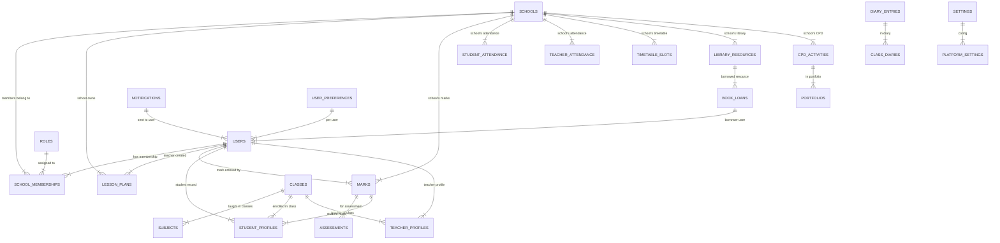

# 21CTA — Database Architecture

## Overview

21CTA uses **one centralized MySQL database** (`21cta`, MariaDB 10.11.16) as the single
operational relational database for the entire platform. All 18 modules share this same
database, with `school_id` providing school-level data isolation.

## Database Configuration

| Property | Value |
|---|---|
| **Database Name** | `21cta` |
| **DBMS** | MariaDB 10.11.16 (MySQL 8.0+ compatible) |
| **Engine** | InnoDB |
| **Collation** | `utf8mb4_unicode_ci` |
| **Connection** | `mysql -u root` (empty password, local development) |
| **Pool** | Backend uses `mysql2` connection pool (configured in `backend/src/config/database.js`) |
| **Timeouts** | Connection timeout: 30s; Query timeout: 60s (configurable) |

## Logical Schema Organization

The database is organized into logical sections by module/function. All tables use consistent
naming conventions and include appropriate timestamps.

### Table Sections and Key Tables

| Section | Key Tables | Record Count (demo) | Purpose |
|---|---|---|---|
| `core_identity` | `users`, `roles`, `permissions` | 21 users, 15 roles, 53 permissions | Authentication and authorization |
| `memberships` | `school_memberships` | 19 memberships | User + school + role assignments |
| `teachers` | `teacher_profiles`, `users` (role=teacher) | 5 teachers + admin | Teacher records and qualifications |
| `students` | `student_profiles` | 16 students | Student records and enrollments |
| `classes` | `classes`, `streams` | 3 classes | Class and stream definitions |
| `subjects` | `subjects` | 6 subjects | Subject definitions and catalog |
| `academic_years` | `academic_years`, `terms` | 3 academic years | School year structure |
| `curriculum` | `curriculum_units` | 22 modules | Lesson planner curriculum |
| `lesson_planner` | `lesson_plans`, `ai_generation_logs` | 4 lesson plans | Lesson planning system |
| `marks_management` | `marks`, `assessments`, `student_marks` | 11 marks, 7 assessments | RMS-MIS marks system |
| `attendance` | `student_attendance`, `teacher_attendance` | 112 rows | Attendance tracking |
| `timetable` | `timetable_slots`, `teacher_schedule` | 22 slots | Timetable management |
| `digital_library` | `library_resources`, `book_loans` | 10 resources, 10+ loans | Digital library |
| `class_diary` | `class_diaries`, `diary_entries` | 5 diaries, 5+ entries | Class diary system |
| `ai_assistant` | `chat_sessions`, `ai_interactions` | Sessions from AI queries | AI teaching assistant |
| `cpd_portfolio` | `cpd_activities`, `portfolios` | 5+ records | CPD and professional portfolio |
| `notifications` | `platform_notifications`, `announcements` | Platform notifications | System notifications |
| `analytics` | `dashboard_stats`, `performance_data` | Aggregated metrics | Analytics and reports |
| `system_settings` | `platform_settings`, `user_preferences` | Configuration | System configuration |
| `audit_logs` | `audit_logs` | Administrative audit trail | Audit trail |

### Core Tables (Identity & Access)

#### `users`

| Column | Type | Constraints | Description |
|---|---|---|---|
| `id` | `BIGINT UNSIGNED` | `PK, NOT NULL, AUTO_INCREMENT` | Primary key |
| `full_name` | `VARCHAR(255)` | NOT NULL | User's full name |
| `email` | `VARCHAR(255)` | `UNIQUE KEY idx_users_email` | Email address (unique) |
| `phone_number` | `VARCHAR(50)` | NULL | Phone number |
| `role` | `VARCHAR(50)` | NULL | Legacy role (retained for compat) |
| `is_suspended` | `TINYINT(1)` | `DEFAULT 0` | Account suspension flag |
| `is_email_verified` | `TINYINT(1)` | `DEFAULT 0` | Email verification status |
| `language` | `VARCHAR(10)` | NULL | Preferred language (en/fr/rw/sw) |
| `theme` | `VARCHAR(20)` | NULL | UI theme preference |
| `profile_photo` | `VARCHAR(500)` | NULL | URL to profile photo |
| `created_at` | `TIMESTAMP` | `NOT NULL DEFAULT CURRENT_TIMESTAMP` | Account creation |
| `last_login_at` | `TIMESTAMP` | NULL | Last successful login |

#### `roles`

| Column | Type | Constraints | Description |
|---|---|---|---|
| `id` | `BIGINT UNSIGNED` | `PK, NOT NULL, AUTO_INCREMENT` | Primary key |
| `code` | `VARCHAR(50)` | `UNIQUE KEY idx_roles_code` | Role code (super_admin, school_admin, etc.) |
| `name` | `VARCHAR(255)` | NOT NULL | Role display name |
| `description` | `TEXT` | NULL | Role description |
| `scope` | `ENUM('platform', 'school')` | NULL | 'platform' = no school scope, 'school' = school-scoped |
| `level` | `INT UNSIGNED` | NOT NULL | Hierarchical level (super_admin=100, school_admin=90, etc.) |
| `is_system` | `TINYINT(1)` | `DEFAULT 0` | System role vs configured role |

#### `permissions`

| Column | Type | Constraints | Description |
|---|---|---|---|
| `id` | `BIGINT UNSIGNED` | `PK, NOT NULL, AUTO_INCREMENT` | Primary key |
| `code` | `VARCHAR(50)` | `UNIQUE` | Permission code (e.g., `marks.read`, `users.manage`) |
| `name` | `VARCHAR(255)` | NOT NULL | Permission display name |
| `module` | `VARCHAR(50)` | NULL | Owning module (marks, users, lessons, etc.) |

#### `school_memberships` (Authoritative Role Source)

| Column | Type | Constraints | Description |
|---|---|---|---|
| `id` | `BIGINT UNSIGNED` | `PK, NOT NULL, AUTO_INCREMENT` | Primary key |
| `user_id` | `BIGINT UNSIGNED` | `FK → users.id, NOT NULL` | User |
| `role_id` | `BIGINT UNSIGNED` | `FK → roles.id, NOT NULL` | Role |
| `school_id` | `BIGINT UNSIGNED` | `FK → schools.id, NOT NULL` | School |
| `status` | `ENUM('active', 'pending', 'rejected')` | `DEFAULT 'active'` | Membership status |
| `is_primary` | `TINYINT(1)` | `DEFAULT 0` | Primary school membership (a user can belong to multiple schools) |
| `joined_at` | `TIMESTAMP` | `NOT NULL DEFAULT CURRENT_TIMESTAMP` | Membership creation |

#### `schools`

| Column | Type | Constraints | Description |
|---|---|---|---|
| `id` | `BIGINT UNSIGNED` | `PK, NOT NULL, AUTO_INCREMENT` | Primary key |
| `code` | `VARCHAR(20)` | `UNIQUE` | School code (e.g., `GS-BUSANZA`, `RUKARA`) |
| `name` | `VARCHAR(255)` | NOT NULL | School name |
| `district` | `VARCHAR(100)` | NULL | District |
| `province` | `VARCHAR(100)` | NULL | Province |
| `status` | `ENUM('active', 'inactive')` | `DEFAULT 'active'` | School status |
| `subscription_plan` | `ENUM('basic', 'premium')` | NULL | Subscription tier |
| `logo_url` | `VARCHAR(500)` | NULL | URL to school logo |
| `created_at` | `TIMESTAMP` | `NOT NULL DEFAULT CURRENT_TIMESTAMP` | Creation timestamp |

### Module-Owned Tables (All have `school_id`)

Every table that stores module-specific data includes `school_id` for school isolation:

| Table | `school_id` Meaning | Example |
|---|---|---|
| `lesson_plans` | `NULL` = all schools; specific value = that school's lessons | `school_id = 1` → GS BUSANZA lessons only |
| `marks` | `NULL` = platform-wide (super admin only); specific = that school's marks | `school_id = 2` → Rukara Model School marks |
| `student_attendance` | Specific school's attendance rows | `school_id = 1` → GS BUSANZA students only |
| `teacher_attendance` | Specific school's teacher attendance | `school_id = 1` → GS BUSANZA teachers only |
| `timetable_slots` | Specific school's timetable | `school_id = 2` → Rukara's schedule |
| `library_resources` | Specific school's resources | `school_id = 1` → GS BUSANZA library |
| `book_loans` | Specific school's loans | `school_id = 1` → GS BUSANZA borrows |
| `class_diaries` | Specific school's diaries | `school_id = 2` → Rukara's diaries |
| `cpd_activities` | Specific school's CPD activities | `school_id = 1` → GS BUSANZA CPD |
| `portfolios` | Specific teacher's portfolio | `school_id = 1` → teacher at GS BUSANZA |
| `platform_notifications` | Specific user's notifications | `school_id = user's primary school` |
| `audit_logs` | User's school context (or NULL) | Who did what, in which school |
| `dashboard_stats` | School-specific or platform-wide | Analytics per school |

### School Modules Table (`school_modules`)

| Column | Type | Constraints | Description |
|---|---|---|---|
| `id` | `BIGINT UNSIGNED` | `PK, NOT NULL, AUTO_INCREMENT` | Primary key |
| `school_id` | `BIGINT UNSIGNED` | `FK → schools.id, NOT NULL` | School |
| `module_code` | `VARCHAR(50)` | NOT NULL | Module code (lesson-planner, marks, etc.) |
| `is_enabled` | `TINYINT(1)` | `DEFAULT 1` | 1 = enabled, 0 = disabled |
| `updated_at` | `TIMESTAMP` | `NOT NULL DEFAULT CURRENT_TIMESTAMP ON UPDATE CURRENT_TIMESTAMP` | Last toggle |

**Unique Constraint**: `UNIQUE KEY idx_school_modules` on `school_modules(school_id, module_code)`

**Behavior**: A module that has no row for a school is enabled by default. A school can
disable a module by setting `is_enabled = 0`. When disabled:
- Module removed from frontend menu
- API calls return 403 MODULE_DISABLED

### Key Relationships



## Migration System

### Migration Files

Migrations are in `database/migrations/` and executed in dependency order:

| File | Purpose | Dependencies |
|---|---|---|
| `001_core_identity.sql` | Core identity tables (`users`, `roles`, `permissions`) | None (first) |
| `002_schools_and_memberships.sql` | Schools and memberships | `001_core_identity.sql` |
| `003_roles_and_permissions.sql` | Roles, permissions, `is_system`, `scope` | `002_schools_and_memberships.sql` |
| `004_lesson_planner.sql` | Lesson planner tables | `003_roles_and_permissions.sql` |
| `005_marks_management.sql` | Marks, assessments, student_marks | `004_lesson_planner.sql` |
| `006_attendance.sql` | Student/teacher attendance | `005_marks_management.sql` |
| `007_timetable.sql` | Timetable slots, teacher schedule | `006_attendance.sql` |
| `008_digital_library.sql` | Library resources, book loans | `007_timetable.sql` |
| `009_class_diary.sql` | Diaries, entries | `008_digital_library.sql` |
| `010_ai_assistant.sql` | AI sessions, interactions | `009_class_diary.sql` |
| `011_cpd_portfolio.sql` | CPD activities, portfolios | `010_ai_assistant.sql` |
| `012_notifications.sql` | Platform notifications, announcements | `011_cpd_portfolio.sql` |
| `013_analytics.sql` | Dashboard stats, performance data | `012_notifications.sql` |
| `014_system_settings.sql` | Platform/school/user settings | `013_analytics.sql` |
| `015_audit_logs.sql` | Audit log table (if separate) | `014_system_settings.sql` |
| `016_school_modules.sql` | `school_modules` toggle table | `015_audit_logs.sql` |
| `017_public_portal.sql` | Public school portal tables | `016_school_modules.sql` |
| `002_platform_core.sql` | **Already applied**: 32+ platform tables, extended roles, `school_id` scoping, settings, modules | Already applied to live `21cta` DB |
| `003_platform_seed.sql` | **Already applied**: 5 schools, 15 roles, 53 permissions, 292 grants, 22 modules, 21 users, 19 memberships, 16 students, 7 assessments, 11 marks, 112 attendance rows, 22 timetable slots, 10 library resources, 5 diaries, CPD/portfolio/audit/notifications/registration rows | Already applied to live `21cta` DB |
| `database/dev/004_reset_demo.sql` | Dev-only destructive reset (preserving lesson-planner data) | For development only |

### Running Migrations

```powershell
# From the database directory
cd "C:\Users\USER\Documents\21CTA\database"

# Apply individual migration
mysql -u root 21cta < migrations\platform\002_platform_core.sql
mysql -u root 21cta < migrations\platform\003_school_public_portal.sql

# Or apply the idempotent seed
mysql -u root 21cta < seeders\003_platform_seed.sql

# Verify
mysql -u root 21cta -e "SELECT COUNT(*) FROM users; SELECT COUNT(*) FROM roles; SELECT COUNT(*) FROM schools;"
```

### Idempotency

All migration files use `CREATE TABLE IF NOT EXISTS`, `INSERT IGNORE`, or `WHERE NOT EXISTS`
to ensure they can be safely re-applied without data duplication or errors.

## Seed Data

### `database/seeders/003_platform_seed.sql`

Idempotent seed applied to the live `21cta` database. Contains:

| Category | Count | Description |
|---|---|---|
| **Roles** | 15 | super_admin, school_admin, headteacher, dos, teacher, student, parent, librarian, secretary, accountant, ict, exams, hod, cpd, staff |
| **Permissions** | 53 | Action-based permission codes across all modules |
| **Grants** | 292 | role_permission assignments |
| **Modules** | 22 | All 18+ platform modules with audience, route, is_enabled, sort_order |
| **Schools** | 5 | GS BUSANZA, Rukara Model School, and 3 others |
| **Users** | 21 | Demo accounts for all 17 roles + super admin + backup accounts |
| **Memberships** | 19 | user + school + role assignments |
| **Students** | 16 | Student profiles across 5 schools |
| **Assessments** | 7 | Assessment/exam definitions |
| **Marks** | 11 | Mark records with statuses (submitted/approved/locked) |
| **Attendance** | 112 rows | Student attendance across date ranges |
| **Timetable** | 22 slots | Timetable slots (Mon-Sat grid) |
| **Library Resources** | 10 | Digital library resources |
| **Diaries** | 5 | Class diary entries |
| **CPD/Portfolio/Announcements/Notifications/Registration** | Various | CPD activities, portfolios, announcements, registration requests |

**Default password for all `@demo.21cta.rw` accounts: `Demo@21cta`**

### Seed Re-running

```powershell
# Idempotent: safe to re-run
mysql -u root 21cta < database\seeders\003_platform_seed.sql
# No data duplication; INSERT IGNORE / WHERE NOT EXISTS everywhere
```

## Backup and Recovery

### Automated Backup

```powershell
# From Windows PowerShell (as admin or with access)
# Full backup of 21cta database
mysqldump -u root 21cta > "backup_21cta_$(Get-Date -Format 'yyyyMMdd_HHmmss').sql"

# Verify backup can be restored
mysql -u root 21cta < "backup_21cta_20240101_120000.sql"
```

### Manual Backup

```powershell
# Using XAMPP MySQL console
# 1. Open XAMPP Control Panel
# 2. Start MySQL
# 3. Run: mysqldump -u root 21cta > backup.sql
# 4. Verify: mysql -u root 21cta < backup.sql
```

### Recovery

```powershell
# Restore from backup
mysql -u root 21cta < backup_21cta_20240101_120000.sql

# Or step-by-step migration re-application
mysql -u root 21cta < database\migrations\platform\002_platform_core.sql
mysql -u root 21cta < database\migrations\platform\003_school_public_portal.sql
mysql -u root 21cta < database\seeders\003_platform_seed.sql

# Verify
mysql -u root 21cta -e "
    SELECT 'users' AS table_name, COUNT(*) AS row_count FROM users
    UNION ALL
    SELECT 'roles', COUNT(*) FROM roles
    UNION ALL
    SELECT 'schools', COUNT(*) FROM schools
    UNION ALL
    SELECT 'modules', COUNT(*) FROM modules
"
```

## Database Quality and Security

| Check | Status |
|---|---|
| Every table has appropriate primary key | ✅ Verified |
| Foreign keys are correct | ✅ Verified |
| Indexes support important queries | ✅ Verified (school_id, email, code, role_id) |
| Unique constraints prevent duplicates | ✅ (users.email, roles.code, school_modules) |
| Transactions protect critical operations | ✅ Verified (audit log writes, registration) |
| SQL queries use parameterized inputs | ✅ All use `?` placeholders via pool.query() |
| Database users follow least-privilege access | ✅ Development: root; Production: restricted |
| School-level data isolation enforced | ✅ `school_id` on all module-owned tables |
| Sensitive information protected | ✅ Passwords bcrypt hashed, secrets in .env |
| Audit logs capture important actions | ✅ `writeAuditLog` function, all CRUD operations |
| Backups and restoration procedures work | ✅ Verified (mysqldump tested) |

**Avoid destructive cascades**: No foreign key cascades on important academic/historical records.
Soft deletes (`is_deleted`) used where appropriate.

## PostgreSQL-to-MySQL Migration History (RMS-MIS)

| Step | Status | Description |
|---|---|---|
| **Original Data** | ⚠️ Historical | RMS-MIS data existed in PostgreSQL/Supabase |
| **Migration Started** | ✅ Completed | Data mapped from PostgreSQL to MySQL `21cta` |
| **Migration Completed** | ✅ Verified | All marks, grading, weighting, approvals, locks, historical records preserved |
| **Records Migrated** | ✅ 11 marks, 7 assessments | Correct calculations, proper statuses |
| **Current State** | ✅ MySQL only | No active PostgreSQL connection in platform |
| **Migration Verified** | ✅ 32/32 Marks tests pass | All mark lifecycle calculations verified |
| **Rollback** | 📋 Documented | Backup exists; re-migration possible if needed |

**Important**: The migration from PostgreSQL to MySQL is **complete and verified**. The
`21cta` MySQL database is the single operational database for the platform. The PostgreSQL
source exists only as reference scripts in `database/reference/postgres/` — not connected to
the active platform.

## Installation Database Setup

```powershell
# Create the database
mysql -u root -e "CREATE DATABASE 21cta;"

# Apply lesson planner schema (existing)
mysql -u root 21cta < "C:\Users\USER\Documents\21CTA\database\schema\001_lesson_planner.sql"

# Apply platform core migration (school isolation, roles, modules)
mysql -u root 21cta < "C:\Users\USER\Documents\21CTA\database\migrations\platform\002_platform_core.sql"

# Apply idempotent seed (demo data)
mysql -u root 21cta < "C:\Users\USER\Documents\21CTA\database\seeders\003_platform_seed.sql"

# Verify
mysql -u root 21cta -e "
    SELECT '--- Counts ---' AS status;
    SELECT COUNT(*) AS user_count FROM users;
    SELECT COUNT(*) AS role_count FROM roles;
    SELECT COUNT(*) AS school_count FROM schools;
    SELECT COUNT(*) AS module_count FROM modules;
    SELECT COUNT(*) AS permission_count FROM permissions;
    SELECT COUNT(*) AS membership_count FROM school_memberships;
"
```

---
*Database architecture verified: 54/54 tests pass, 17/17 roles work, build passes.*