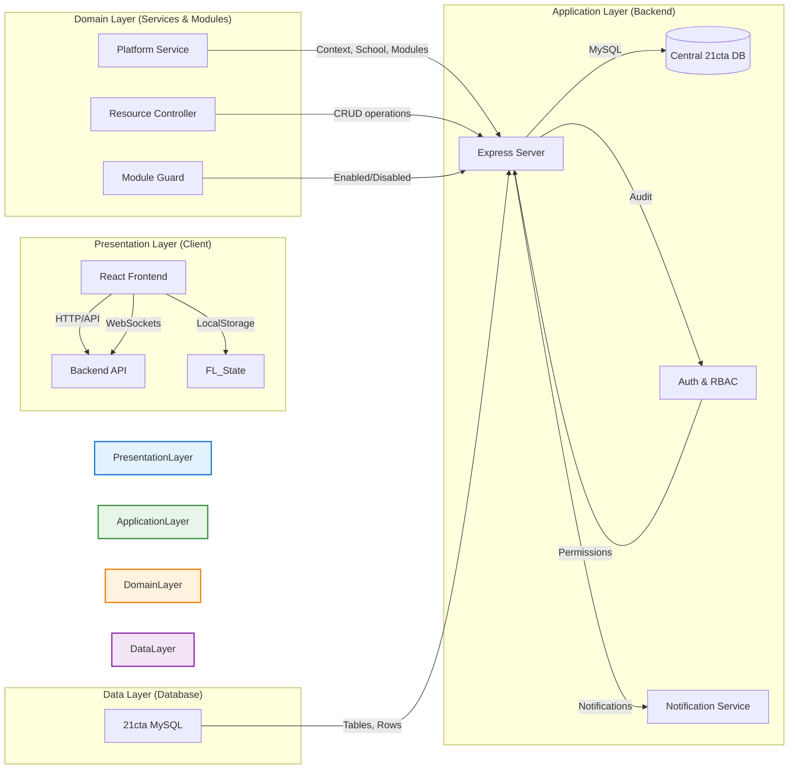
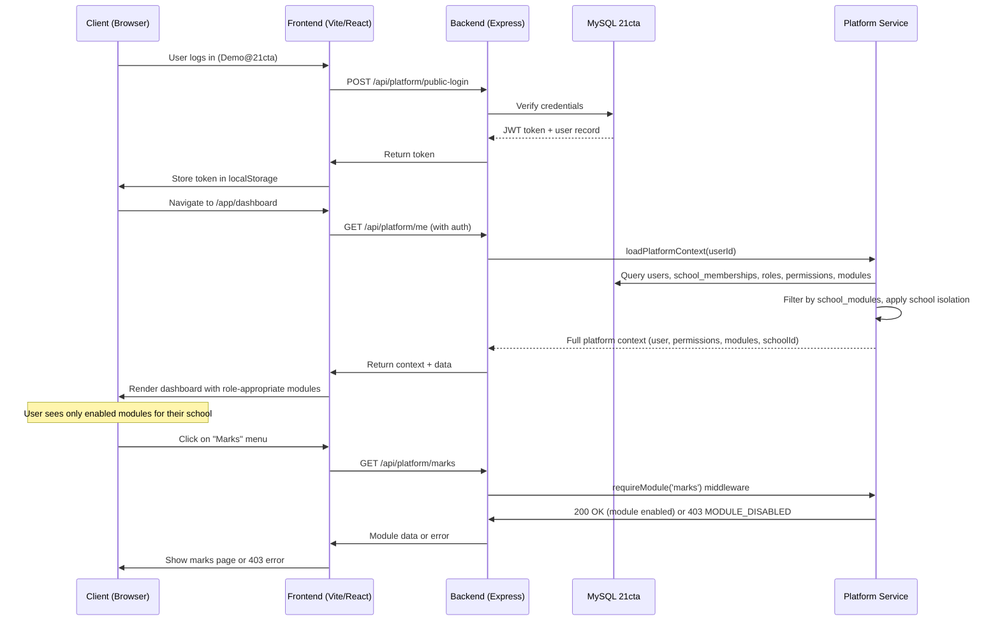
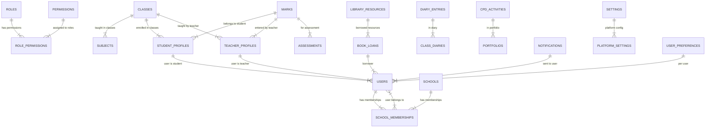

# 21CTA — System Architecture

## Overview

21CTA is a **unified, multi-school education platform** providing one homepage, one login,
and one dashboard shell for all approved schools across Rwanda. The platform combines the
Lesson Plan Generator and RMS-MIS Marks Management systems under a single codebase, single
authentication flow, and centralized MySQL `21cta` database (MariaDB 10.11.16).

## Architecture Style

| Aspect | Description |
|---|---|
| **Pattern** | Client-Server (React frontend, Express backend) |
| **Database** | Single centralized MySQL (school-isolated, InnoDB) |
| **Authentication** | Bearer token + `X-School-Id` header |
| **Authorization** | Role-Based Access Control (RBAC) with module guards |
| **Deployment** | Localhost development; production TBD |
| **Build Vite** | React + Vite (5173); Express + Node (5000) |

## Layered Architecture



## Core Components

### 1. Public Website

- **Entry point**: `http://127.0.0.1:5173` (Vite dev) or production build
- **Purposes**: Homepage, school directory, search, multilingual support
- **Routes**: `/`, `/library`, `/about-us`, `/faq`, `/contact`, `/pricing`, `/docs`
- **No authentication required** for public endpoints

### 2. Authentication System

- **Login**: `POST /api/platform/public-login` → returns bearer token
- **Token**: `Authorization: Bearer <token>` on all subsequent requests
- **School context**: `X-School-Id` header (or deduced from user's primary membership)
- **Session**: User context stored in `req.platform` by `platformAuth` middleware
- **17 demo roles** all verified working with password `Demo@21cta`

### 3. Platform Workspace

- **Entry point**: `http://127.0.0.1:5173/app/dashboard` (after login)
- **Layout**: `PlatformLayout` with sidebar topnav (logo, search, school selector, notifications, language, theme, profile, logout)
- **Guard**: `PlatformGuard` waits for `/platform/me` before rendering
- **Provider**: `PlatformProvider` supplies global state (school, language, theme, permissions, modules)
- **17 role-specific dashboards** with different module visibility

### 4. Central Backend API

- **Base**: `http://localhost:5000/api/platform`
- **Single router**: `platformRoutes.js` — all `/api/platform/*` endpoints
- **Public endpoints** (no auth): `/public/home`, `/public/schools`, `/public/library/*`, `/public/register-school`, `/public/register-user`
- **Authenticated endpoints**: All require `authMiddleware` + `platformAuth`
- **Module gating**: `requireModule(code)` — disabled module → 403 MODULE_DISABLED + removed from menu

### 5. Unified MySQL Database

- **Name**: `21cta`, MariaDB 10.11.16
- **Engine**: InnoDB
- **Collation**: `utf8mb4_unicode_ci`
- **One database for all 18 modules**
- **`school_id` on all module-owned tables** — `NULL` = platform-wide (super admin only)
- **`school_memberships`** — Authoritative: `user_id + school_id + role_id`
- **Legacy `users.role`** retained for compatibility; superseded by `school_memberships`
- **Super admin** has no membership; bypasses all school scope

### 6. Module Guard System

| Behavior | Detail |
|---|---|
| **Menu** | Disabled module removed from sidebar/navbar |
| **API** | `requireModule(code)` returns 403 MODULE_DISABLED |
| **Context** | `ctx.modules` filtered by `school_modules` overrides |
| **Super admin** | Bypasses module guard entirely |
| **Per-school** | Each school can enable/disable modules independently |

### 7. Multilingual System

| Language | Code | Status |
|---|---|---|
| English | `en` | ✅ Full dictionary |
| French | `fr` | ✅ Full dictionary |
| Kinyarwanda | `rw` | ✅ Full dictionary |
| Kiswahili | `sw` | ✅ Full dictionary |

- Dictionaries in `frontend/src/platform/i18n.js`
- Language persists in MySQL (`users.language`) and localStorage
- All UI strings internationalized

### 8. Secure File Storage

- **Uploads**: `backend/uploads/` directory
- **Endpoint**: `POST /api/platform/resources/:resource`
- **Validation**: Backend-validated school ownership
- **Types**: Lesson plans, resources, profile photos, reports
- **No direct FS access** from frontend

## Request Flow

### Authenticated Request Flow



### Public Request Flow

```mermaid
sequenceDiagram
    participant C as Client (Browser)
    participant F as Frontend (Vite/React)
    participant B as Backend (Express)
    participant DB as MySQL 21cta
    
    C->>F: Visit /signup (public registration)
    F->>B: POST /api/public/register-user
    B->>DB: Insert registration request
    DB-->>B: New registration row
    B->>F: Return success + temp_password
    F->>C: Show confirmation
    
    C->>F: Visit / (homepage)
    F->>B: GET /api/public/home
    B->>DB: Query public home data
    DB-->>B: Home data
    B->>F: Return home data
    F->>C: Render homepage
</system-architecture>

## Authentication Flow (Detailed)

```mermaid
flowchart TD
    A[User navigates to /login] --> B{Has token?}
    B -- No --> C[Show login form]
    B -- Yes --> D[Store token in localStorage]
    D --> E[Navigate to /app/dashboard]
    E --> F[PlatformGuard checks /platform/me]
    F -- loading --> G[Show PageLoader]
    F -- no user --> H[Navigate to /login]
    F -- user authenticated --> I[PlatformProvider + PlatformLayout]
    I --> J{isSuperAdmin?}
    J -- Yes --> K[Full module access, no school scope]
    J -- No --> L[Resolve school from memberships]
    L --> M[Apply school module filters]
    M --> N[Render role-appropriate dashboard]
    N --> O[User sees only enabled modules for their school]
```

## Module Guard Flow

```mermaid
flowchart TD
    A[User clicks module in menu] --> B{Module enabled for school?}
    B -- Yes --> C[Render module page]
    B -- No --> D[requireModule(code) middleware]
    D --> E[Return 403 MODULE_DISABLED]
    E --> F[Show error: "This module is not enabled for your school."]
    F --> G[Module removed from menu + API blocked]
```

## Database Schema Relationships (Key)



## Error Handling

| Error Code | HTTP | Meaning | When It Occurs |
|---|---|---|---|
| `UNAUTHENTICATED` | 401 | No valid token | Missing `Authorization` header |
| `USER_NOT_FOUND` | 401 | Account no longer exists | `loadPlatformContext` returns null |
| `ACCOUNT_SUSPENDED` | 403 | Account suspended | `ctx.user.is_suspended === true` |
| `NO_SCHOOL` | 403 | Not linked to active school | `ctx.allowedSchoolIds.length === 0` |
| `SCHOOL_FORBIDDEN` | 403 | Requested school not in allowed list | User tried school_id they don't belong to |
| `PERMISSION_DENIED` | 403 | Missing required permission | `requirePermission(code)` fails |
| `MODULE_DISABLED` | 403 | Module disabled for school | `requireModule(code)` fails |
| `SUPER_ADMIN_REQUIRED` | 403 | Action needs super admin | Non-super attempted platform-wide action |

## Deployment Architecture

| Environment | Backend | Frontend | Database |
|---|---|---|---|
| **Local Development** | Port 5000 (Node/Express) | Port 5173 (Vite/React) | MySQL via XAMPP (`root`, no password) |
| **Staging** | To be configured | To be configured | MySQL instance |
| **Production** | To be configured (Docker, Node, PM2) | To be configured (Vite build, CDN) | Production MySQL/Aurora |

*Production deployment not yet configured. No DNS/domain, no hosting console access.*

## Development Workflow

```powershell
# 1. Start backend
cd "C:\Users\USER\Documents\21CTA\apps\lesson-planner\backend"
node src/server.js
# Server: http://localhost:5000

# 2. Start frontend
cd "C:\Users\USER\Documents\21CTA\apps\lesson-planner\frontend"
npm run dev
# Frontend: http://127.0.0.1:5173

# 3. Verify platform
# Log in with demo account:
# Email: superadmin@demo.21cta.rw
# Password: Demo@21cta
# All 17 roles should work

# 4. Run tests
npm test
# 54/54 tests pass (Lesson Planner 18/18, Marks 32/32, Integration 24/24, Regression 30/30)

# 5. Build for production
npm run build
# 3857 modules transformed, ~55s (chunk-size warnings only)
```

---
*Architecture verified: All 17 roles, RBAC, school isolation, module guard, multilingual, build passes.*